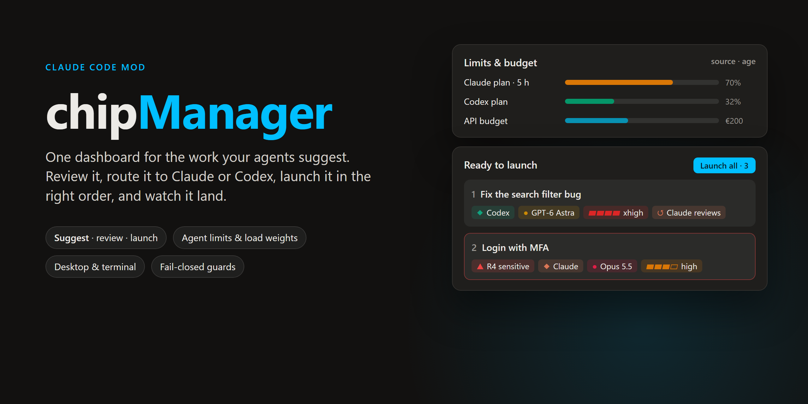
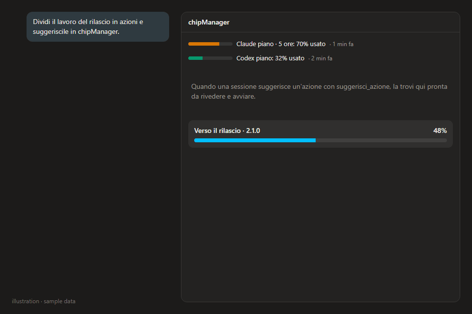
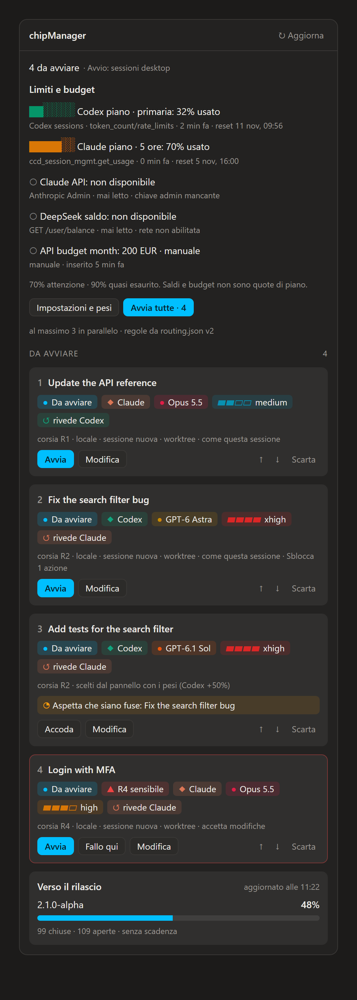
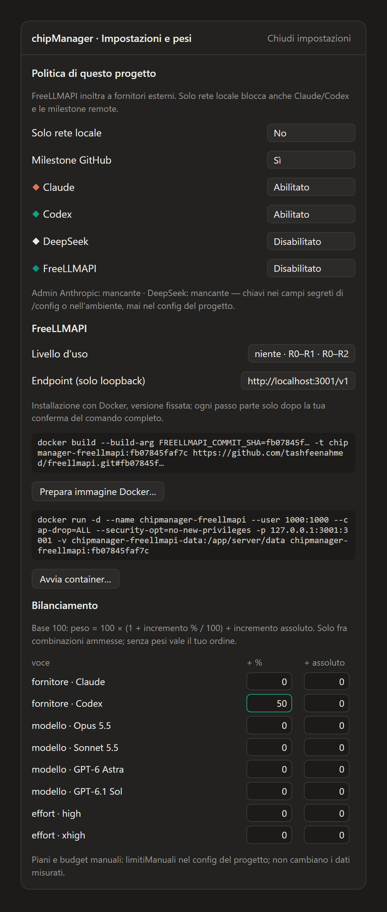
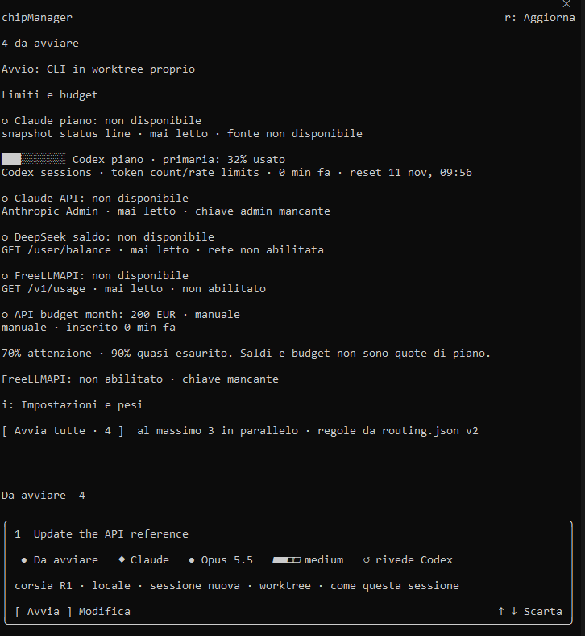
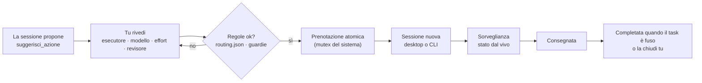
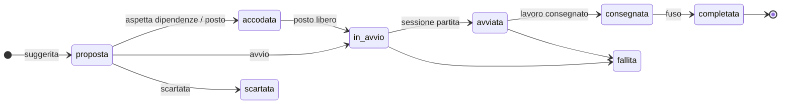

<div align="center">

[English](README.md) · **Italiano**



[](#installazione)
[](#)
[](#immagini)
[](#collaudo)
[](LICENSE)

**[Perché](#perché)** · **[Funzioni](#funzioni)** · **[Immagini](#immagini)** · **[Installazione](#installazione)** · **[Un progetto o tutti](#installare-per-un-progetto-o-per-tutti)** · **[Primi passi](#primi-passi)** · **[Come funziona](#come-funziona)** · **[Dove eseguire](#dove-eseguire)** · **[Chi lavora](#chi-lavora)** · **[Auditor](#auditor-advisor)** · **[Account e progetto](#account-e-progetto)** · **[Impostazioni](#impostazioni)** · **[Configurazione](#configurazione)** · **[Limiti e pesi](#limiti-e-bilanciamento)** · **[FreeLLMAPI](#freellmapi)** · **[Lingue](#lingue)** · **[Terminale](#terminale)** · **[Aspetto](#aspetto)** · **[Sicurezza](#sicurezza-e-guardie)** · **[Domande](#domande)**

</div>

---

## Perché

Lavorando con più sessioni di agenti insieme, la parte difficile non è il codice: è **non perdere il filo**.
Le proposte finiscono sparse come chip nelle chat, ognuna ricopiata a mano in una sessione nuova, e nessuno
ricorda quale sessione sta facendo cosa, quale aspetta una tua risposta e cosa è già stato fuso.

**chipManager** mette tutto il lavoro suggerito in un pannello accanto alla conversazione. Una sessione propone,
tu rivedi e indirizzi — Claude o Codex, quale modello, quale effort, chi rivede — e avvii, una alla volta o tutte
insieme nell'ordine delle dipendenze. Il pannello segue ogni avvio dal vivo e lo toglie quando è arrivato.

La mod è **generica**: dà al modello gli strumenti e i dati (limiti, pesi, fornitori ammessi) ed è il modello a
decidere come usarli nel progetto in cui lavora. Tutto ciò che è proprio di un progetto sta in un file locale.

## Funzioni

In ordine di quanto le userai.

- **Una sola coda per il lavoro suggerito** — le sessioni chiamano `suggerisci_azione` invece di scrivere chip in
  chat; tu le rivedi, le instradi e le avvii da un solo pannello.
- **Chi fa cosa, adesso** — la vista **Lavoro** elenca tutte le sessioni del progetto, anche quelle aperte a mano e
  quelle Codex: lavoro, motore, modello, effort, stato, contesto usato e ultima attività. Sopra, una riga di sintesi
  («3 al lavoro · 1 aspetta te · Claude 76% usato»); sotto, aspettano te · da avviare e in coda · da fondere.
- **Avvia una chip o tutte** — **▶ Avvia** su ogni chip pronta, **Avvia la prossima** (`n`), **Avvia tutte** (`a`)
  nell'ordine delle dipendenze, un tetto alle sessioni in parallelo, una corsia Codex per macchina; una chip bloccata
  dice perché.
- **Chi lavora, a colpo d'occhio** — ogni chip mostra motore · modello · effort, poi auditor · revisore · corsia, con
  il motivo della scelta consigliata. I preset (**Consigliato**, **Economico**, **Qualità**) si vedono in anteprima
  prima di applicarli, «modificato a mano» arriva con **Ripristina consigliato**, e le scelte complete stanno in
  **Dettagli**. Vedi [Chi lavora](#chi-lavora).
- **Dove eseguire** — su questo computer, nel cloud di Claude o **qui a crediti API**, con un budget mensile e un
  tetto per esecuzione. Un consigliere di destinazione può suggerire o applicare dove gira ogni chip. Vedi
  [Dove eseguire](#dove-eseguire).
- **Configurazione con un clic** — la sezione **Esecuzione** controlla da sola che cosa è pronto (accesso a Claude,
  GitHub, la chiave API, impostazioni compatibili, budget) e offre l'unica azione che sistema ogni pezzo mancante,
  oppure la procedura **Configura Esecuzione**. Niente terminale.
- **Cambiare una sessione in corso** — **Cambia modello** e **Cambia effort** sulle sessioni desktop avviate da questo
  pannello, con una conferma e le stesse guardie dell'avvio.
- **Auditor (advisor)** — affianca a una chip un modello più forte che Claude Code consulta mentre lavora, controllato
  sulle coppie documentate. Vedi [Auditor](#auditor-advisor).
- **Limiti degli agenti a colpo d'occhio** — piano Claude, piano Codex, spesa API, saldi e budget manuali, ciascuno con
  **fonte ed età**; le percentuali dicono sempre quanto è **usato** («76% usato»), mai quanto resta. Ignoto vuol dire
  ignoto.
- **Impostazioni con Applica** — le modifiche aspettano in una bozza finché **Applica** le scrive in un colpo solo
  (budget manuali, collegamenti e proposte di pesi applicate si scrivono subito); una modifica di un'altra sessione
  sullo stesso campo chiede prima di sovrascrivere. Le sessioni possono **proporre**
  impostazioni o pesi; decidi tu.
- **Account e progetto** — soglie, budget e crediti API appartengono ai tuoi account e valgono in ogni progetto;
  ogni progetto può solo essere più severo. La mod si installa per tutti i progetti o per un repository. Vedi
  [Account e progetto](#account-e-progetto).
- **Pesi di carico e profili** — Automatico, Risparmio, Qualità, Velocità, oppure fornitori, modelli ed effort
  regolati su una scala di cinque passi; il pannello sceglie solo fra le combinazioni che le tue regole ammettono.
- **Stile developer** — stati come glifo + parola, dati in monospazio, barre a blocchi, l'accento solo per la
  grafica, lo stesso aspetto su desktop e terminale. Vedi [Aspetto](#aspetto).
- **Sei lingue** — inglese per difetto, più italiano, spagnolo, francese, tedesco e portoghese brasiliano.
- **Board di progetto, a richiesta** — una pagina HTML locale con la linea di lavoro e, per ogni compito, piano,
  mandato, processo, responsabile, effort e revisione. Costruita senza modelli; i riassunti di una frase sono una
  scelta a parte.
- **FreeLLMAPI, a richiesta** — installazione Docker guidata di una versione fissata, per scaricare compiti testuali
  brevi e a basso impatto.
- **Avanzamento delle milestone** — milestone GitHub aperte con percentuale e una stima dal ritmo di chiusura recente.
- **Guardie fail-closed** — il lavoro sensibile è sempre rivisto da Claude, una prenotazione atomica perché niente
  parta due volte, regole rilette prima di ogni decisione, chiavi nelle opzioni sicure di Claude Code (la chiave API
  sta in un file temporaneo, leggibile solo dal tuo utente, solo durante un'esecuzione).

## Immagini

<p align="center"><br><sub><b>In movimento.</b> Una sessione suggerisce tre azioni; un solo avvio le lancia nell'ordine delle dipendenze, e ogni scheda esce dal pannello una volta fusa. Illustrazione con dati d'esempio.</sub></p>

<table>
<tr>
<td width="50%" valign="top"><br><sub><b>App desktop — il pannello.</b> Limiti con fonte ed età, quattro azioni suggerite: una dipendenza che aspetta la fusione, un'azione sensibile (R4) riservata a Claude, la milestone del rilascio in fondo.</sub></td>
<td width="50%" valign="top"><br><sub><b>Impostazioni e pesi.</b> Politica dei fornitori per progetto, chiavi mostrate solo come impostata / mancante, i passi d'installazione di FreeLLMAPI con i comandi completi, e i pesi di carico (qui Codex +50%).</sub></td>
</tr>
<tr>
<td colspan="2" align="center"><br><sub><b>Terminale — screenshot reale.</b> Lo stesso pannello in Claude Code da riga di comando, con il lanciatore CLI.</sub></td>
</tr>
</table>

<sub>Dati d'esempio. Queste immagini sono precedenti alla 2.2.0 e saranno sostituite da catture di questa versione: il pannello ora si apre in inglese (l'italiano si sceglie in Impostazioni), con lo [stile developer](#aspetto) descritto più sotto.</sub>

## Installazione

Al prompt di una sessione Claude Code nel terminale:

```bash
/plugin install chip-manager --marketplace Elite9400/chipManager
```

Da una shell:

```bash
claude plugin install chip-manager --marketplace Elite9400/chipManager
```

Nell'app desktop, dove `/plugin` non è disponibile: **+** accanto al campo del prompt → **Plugins** →
**Add marketplace** con `Elite9400/chipManager` → **Add plugin**. Un plugin installato dal terminale a livello
utente compare anche nelle sessioni dell'app desktop.

<details>
<summary>Da una cartella locale (sviluppo)</summary>

```bash
claude plugin marketplace add <cartella di chipManager>
```

```bash
claude plugin install chip-manager@chipmanager --scope user
```

L'installazione da cartella legge dalla cartella: non spostarla. Dopo una modifica
`claude plugin marketplace update chipmanager`; le sessioni aperte la ricaricano al riavvio.

</details>

### Installare per un progetto o per tutti

La mod si comporta allo stesso modo in ogni ambito: account, chiavi e budget API sono sempre tuoi, e le chip
appartengono sempre al progetto della sessione che le avvia.

| Ambito | Comando | Dove si abilita |
|---|---|---|
| Tutti i tuoi progetti | `claude plugin install chip-manager@chipmanager --scope user` | le tue impostazioni utente (il predefinito) |
| Un repository, condiviso con il team | `claude plugin install chip-manager@chipmanager --scope project` | `.claude/settings.json` del repository, nel commit |
| Un progetto, solo per te | `claude plugin install chip-manager@chipmanager --scope local` | `.claude/settings.local.json` del repository, fuori dal commit |

- **Gli account restano personali**, anche quando la mod è installata per il team: ognuno accede, mette le chiavi in
  `/config` e tiene le impostazioni dell'account nella propria cartella utente.
- **Niente finisce nel repository.** I dati della mod (configurazione, cartelle dati, registro della spesa API,
  board) restano nella tua cartella utente (`~/.claude/chipmanager`). Se ne indichi uno dentro un repository o
  attraverso un link o una junction, la mod si rifiuta e dice perché.
- **Dopo un aggiornamento ricarica tutte le sessioni aperte** (`/reload-plugins`). Finché non lo fai, una sessione
  tiene il codice vecchio: applica solo le impostazioni del progetto e ignora quelle dell'account.

## Primi passi

1. **Installa** la mod (sopra) e apri una sessione in un repository git. Il pannello si apre da solo;
   `/chipmanager` lo riapre.
2. **Dagli le regole**: metti un `routing.json` nel repo (predefinito `.claude/routing.json`, vedi
   [Configurazione](#configurazione)). Senza regole il pannello mostra tutto ma non avvia niente.
3. **Chiedi al modello** di pianificare nel pannello: *«Dividi il lavoro in azioni e suggeriscile in chipManager»*.
   Chiama `suggerisci_azione` una volta per azione, con le dipendenze, e può leggere prima `risorse_agenti`.
4. **Rivedi e avvia**: apri **Dettagli** su una chip per vedere chi ci lavora e cambiare ciò che vuoi, poi
   **▶ Avvia**, o **Avvia tutte** per l'intera coda.

Il pannello ha tre viste: **Lavoro** (chi fa cosa, la coda, quello che aspetta te), **Carico** (limiti e budget) e
**Impostazioni**. I tasti `1` `2` `3` le scelgono anche da tastiera. La lingua si cambia in
**Impostazioni → Lingua** (le etichette qui sotto sono quelle italiane).

## Come funziona



Ogni azione ha un solo ciclo di vita:



### Strumenti MCP

| Strumento | Per | Che cosa fa |
|---|---|---|
| `suggerisci_azione` | il modello che propone | mette un'azione nel pannello con titolo, mandato autoportante, ordine, dipendenze e pre-impostazioni (motore, modello, effort, corsia, destinazione) |
| `risorse_agenti` | il modello che propone | sola lettura: limiti con fonte ed età, pesi, fornitori, modelli ed effort ammessi, le destinazioni con i loro margini e le impostazioni correnti che una sessione può proporre; delle chiavi solo impostata / mancante |
| `aggiorna_azione` | le sessioni avviate | segna l'azione *consegnata* (o *fallita*) con il gettone di tentativo scritto nel mandato; riferisce l'esito della revisione (`revisione`), anche senza stato |
| `proponi_pesi` | una sessione, su richiesta | propone un profilo di bilanciamento o regolazioni dei pesi; il titolare la applica o la rifiuta dal pannello, e può annullarla |
| `proponi_impostazioni` | una sessione, solo quando lo chiedi tu | propone impostazioni; una proposta valida riempie la bozza delle Impostazioni, non cambia niente finché non premi **Applica** |

## Dove eseguire

Ogni chip ha una destinazione, scelta in **Dettagli → Come parte la sessione → Dove**, o per più chip insieme con le
caselle di selezione e la barra **→ locale / cloud / API Claude**. Una destinazione che una chip non può usare si
vede con il suo motivo, mai nascosta in silenzio.

| Destinazione | Che cosa gira | Limiti e costo |
|---|---|---|
| **Su questo computer** | una nuova sessione desktop (o il lanciatore CLI nel terminale) | i limiti del tuo piano |
| **Nel cloud** (solo sessione nuova) | una sessione cloud di Claude dal ramo pubblicato | i limiti del tuo piano; serve un repository GitHub |
| **Qui a crediti API (Claude)** | `claude -p` su questo computer, nel suo worktree, con la chiave API | i tuoi crediti API, entro un budget mensile |

**API Claude (crediti).**

- **La chiave** va solo nelle opzioni del plugin (**/config → chip-manager → Anthropic API (credits)**), custodita
  nell'archivio sicuro dell'host, mai nella configurazione, in un mandato o nel pannello. Il pannello controlla solo
  che ci sia. Durante un'esecuzione la chiave è scritta in un file-chiave temporaneo, leggibile solo dal tuo utente,
  creato subito prima dell'avvio e cancellato alla fine.
- **Usa una chiave dedicata.** Crea una chiave solo per la mod, in un workspace della Console con un limite di spesa
  mensile basso: è l'unico tetto che nessun processo locale può superare, e la mod non può verificarlo.
- **Che cosa una chiave può e non può proteggere.** Durante un'esecuzione la chiave è raggiungibile dall'agente e dai
  suoi strumenti, come qualunque chiave data a un agente. Dopo, il file-chiave viene cancellato e la copia in memoria
  di Claude scade entro 5 minuti; questo non revoca la chiave. Se pensi che sia stata copiata, revocala dalla Console
  e creane una nuova: con una chiave dedicata alla mod puoi farlo senza toccare le altre.
- **Budget e tetto.** Ogni esecuzione prenota il suo tetto sul budget del mese prima di partire e si ferma lì
  (`--max-budget-usd`); il tetto può comunque essere superato di poco, e la spesa è una stima: l'unico tetto vero è
  il limite di spesa del workspace della chiave nella Console. Un'esecuzione con esito
  incerto conta il tetto intero. La vista **Carico** mostra la spesa del mese rispetto al budget.
- **Un'esecuzione per macchina.** Un lock della macchina tiene le esecuzioni API una alla volta; se un'esecuzione
  lascia qualcosa, il pannello dice che cosa e offre **Libera** o **Termina i processi**.
- **Le impostazioni che cambiano chi paga** (un gateway, un metodo di accesso, un `apiKeyHelper`, credenziali o URL
  base in `env`) bloccano la corsia, in qualunque fonte di impostazioni; il pannello nomina il file e l'impostazione
  e non li modifica mai.

**Cloud di Claude.** Servono un piano idoneo (Pro, Max, Ultra, Team o Enterprise), il login claude.ai, il repository
collegato su claude.ai/code e un ambiente cloud. Usa i limiti del piano, e ogni chip nel cloud chiede la conferma del
testo intero. I crediti extra nel cloud non sono documentati: verifica sul tuo account.

**Consigliere di destinazione.** In **Impostazioni → Esecuzione → Consiglia dove eseguire**: *Spento*, *Suggerisci*
(una riga su ogni chip) o *Applica alle chip senza destinazione*. Sceglie solo dove (questo computer, cloud, API);
pesi e profili scelgono ancora modello ed effort, e le scelte esplicite non si toccano mai.

**Configurazione con un clic.** **Impostazioni → Esecuzione → Che cosa è pronto** controlla da sola, quando la apri e
con **Ricontrolla**:

- l'accesso a Claude (solo se c'è o no, mai l'account) — **Accedi** apre il login nel browser;
- GitHub e il remoto del progetto — **Collega GitHub** apre il login nel browser;
- la chiave API, presente o no — **Inserisci la chiave** apre `/config` e mostra dove incollarla;
- fonti di impostazioni compatibili con le esecuzioni API — un file che blocca si vede con la sua impostazione e
  **Copia percorso**;
- budget e tetto.

Dopo un accesso il pannello ricontrolla ogni 5 secondi, fino a 3 minuti, finché la sezione è aperta. Se un accesso non
può partire, il pannello mostra il comando con **Copia**. **Configura Esecuzione** percorre i passi mancanti uno alla
volta, ognuno si può saltare, e si chiude quando è tutto pronto.

## Chi lavora

Ogni chip mostra chi farà il lavoro, in una sintesi in stile developer:

```
Claude · Opus 5.5 · ▰▰▰▱ high
auditor Fable 5.1 · rev Codex · R3
consigliato: corsia R3 · profilo Automatico · piano Claude usato al 42%
```

- **Preset** — **Consigliato** (quello che sceglierebbe il bilanciamento), **Economico** (più economico: Claude di rango
  più basso a parità di punteggio, non aggiunge mai un auditor) e **Qualità** (effort più alto, può aggiungere un
  auditor sulle corsie alte, con il costo detto). Un preset mostra prima un'anteprima nella sintesi; **Applica** lo
  scrive. Corsia, revisore e destinazione non si toccano mai, e un auditor scelto da te resta finché è ancora una
  coppia valida.
- **«modificato a mano»** compare quando le tue scelte differiscono da quelle consigliate, con
  **Ripristina consigliato**.
- **Dettagli** (chiuso per difetto) contiene motore, modello, effort, auditor, revisore e corsia, con la legenda della
  corsia. Le scelte non ammesse non si offrono, e il motivo si vede.
- **Le sessioni in corso** mostrano la stessa sintesi, in sola lettura. Sulle sessioni desktop avviate da questo
  pannello con Claude, **Cambia modello** e **Cambia effort** cambiano la sessione dal turno successivo, dopo una
  conferma. Il pannello ricontrolla sessione, tentativo e regole della corsia, rifiuta un cambio che altererebbe il
  revisore già nominato nel mandato, e verifica il risultato; se non può, dice *incerto* con **Ricontrolla**, senza
  mai ritentare da solo.

## Auditor (advisor)

L'**advisor** di Claude Code permette al modello al lavoro di consultare un modello più forte quando lo ritiene utile.
chipManager lo chiama **auditor** e te lo fa scegliere per ogni chip: *nessuno*, Sonnet, Opus, Fable o un id di
modello completo.

- **Solo coppie documentate.** Le coppie vengono dalla tabella dell'advisor di Claude Code, tenuta in un solo punto con
  fonte e data. Una coppia fuori tabella non si può scegliere e blocca l'avvio (Claude Code la ignorerebbe in
  silenzio); nemmeno gli id di modello sconosciuti si possono scegliere. L'auditor funziona solo con Claude come
  esecutore, e mai nel cloud.
- **API Claude: per sessione.** Sulla corsia API l'auditor passa con `--advisor` solo a quell'esecuzione. Dopo, la chip
  dice che cosa è successo: applicato, ereditato dalle impostazioni, nessuno o spento. Se all'avvio l'advisor non è
  disponibile (consenso per Fable, `availableModels`), la chip lo dice e offre **Riavvia senza auditor**, che imposta
  `CLAUDE_CODE_DISABLE_ADVISOR_TOOL=1` solo per quell'esecuzione, a meno che un file di impostazioni non lo scavalchi.
- **Sessioni desktop e terminale: a mano.** Lì non c'è un'impostazione per sessione. La chip ti dice di scrivere
  `/advisor <modello>` in quella sessione, con **Copia**: cambia **il tuo default per tutte le sessioni** (tranne
  Remote Control e i worker remoti), quindi scrivi `/advisor off` quando hai finito. La mod non scrive mai
  `advisorModel` da sola, e quello che una sessione eredita non si verifica.
- **Fable** come auditor richiede, su alcuni piani, un consenso una tantum che dai tu con `/model fable` in una sessione
  interattiva; la mod non lo dà mai. L'uso di Fable può essere addebitato ai crediti d'uso.

## Account e progetto

Le impostazioni stanno in due strati.

- **Account — tutti i progetti.** Soglie, budget manuali, crediti API Claude (budget mensile e tetto per esecuzione) ed
  endpoint FreeLLMAPI. Percentuali dei piani, budget e spesa API sono dell'account, uguali in ogni progetto.
- **Progetto — il repository della sessione.** Fornitori ammessi, solo rete locale, milestone, bilanciamento (profilo
  e pesi), board, consigliere di destinazione, livello FreeLLMAPI, cartella dati e termini sensibili.
- **Solo fornitori connessi.** DeepSeek e FreeLLMAPI contano come connessi solo con la loro chiave nelle opzioni della
  mod (i piani Claude e Codex sempre): senza, un fornitore ammesso mostra «Non connesso», resta fuori dalle scelte
  automatiche, e una chip che lo nomina non parte.
- **Un progetto può solo essere più severo.** Può avere soglie più basse, un limite del mese o un tetto per
  esecuzione API più bassi; non può mai allargare l'account, e un valore più largo è rifiutato con il motivo. Le
  Impostazioni mostrano un valore del progetto come «Più severa in owner/repo», con **Rimuovi restrizione**.
- **Un solo registro della spesa API, dell'account.** Ogni esecuzione è registrata con il suo progetto. Parte solo se
  il suo tetto sta sia in ciò che resta del budget mensile dell'account sia nel limite del mese del progetto, se ne ha
  uno. La vista **Carico** li mostra entrambi: «3,20 USD questo progetto · 7,80 USD di 20 USD account».
- **Aggiornamento.** Nella configurazione niente si sposta né si cancella: l'account è un campo nuovo accanto ai
  progetti. Soglie o budget API salvati su un progetto da un build di sviluppo valgono come restrizioni di quel
  progetto; la corsia API Claude resta spenta finché non metti il budget in **Impostazioni → Esecuzione**.

## Impostazioni

La vista **Impostazioni** mostra una sezione alla volta, in due gruppi: **Account · tutti i progetti** (Connessioni,
Soglie con i budget manuali, Modo di lavoro, Esecuzione, Lingua) e **Progetto · owner/repo** (Bilanciamento,
Progetto, Board, Avanzate, Legenda).

- **Modo di lavoro.** Effort predefinito per corsia (R0–R2 `medium`, R3–R5 `high`; R4/R5 mai sotto), la sandbox di
  Codex quando esegue (`workspace-write` modifica i file e la sessione Claude fa i commit; `read-only`), le sessioni
  avviate insieme (sopra l'opzione dell'host), l'auditor suggerito e la revisione incrociata su R0–R2. Vale per tutti
  i progetti o si sostituisce per questo progetto; preset Consigliato, Economico e Qualità.

- **Applica.** Ogni modifica va in una bozza e si valida subito (l'errore resta sotto il controllo). **Applica** scrive
  l'intera bozza — progetto, account e lingua — con un solo compare-and-swap; **Annulla modifiche** la scarta. Tre
  cose non stanno nella bozza e si scrivono subito: budget manuali, collegamenti e proposte di pesi che applichi;
  **Annulla modifiche** non le annulla. Se un'altra sessione ha cambiato uno
  degli stessi campi non si scrive niente, e un popup offre **Ricarica e riapplica la mia bozza** o
  **Scarta la mia bozza**. Uscire dalle Impostazioni con una bozza chiede Applica, Annulla o Resta.
- **Proposte dalle sessioni.** Una sessione può proporre impostazioni con `proponi_impostazioni`, ma solo quando glielo
  chiedi tu, con una patch `progetto` (profilo, board, consigliere di destinazione, restrizioni) e una patch `account`
  (soglie, budget e tetto API), più la lingua; qualunque altro campo (chiavi, guardie, permessi, fornitori,
  destinazioni) rifiuta l'intera proposta. Una proposta valida riempie la bozza sotto un banner «Proposta da una
  sessione», che dice quando cambia le impostazioni di tutti i progetti; non cambia niente finché non premi **Applica**. Con una
  bozza già aperta aspetta, una alla volta. Le proposte di pesi (`proponi_pesi`) compaiono come una riga nella vista
  Lavoro con **Rivedi**, **Applica**, **Rifiuta** e, dopo l'applicazione, **Annulla**.

## Configurazione guidata

`/chipmanager --setup` apre nel pannello una configurazione guidata: lingua, fornitori, accessi (Claude, Codex,
GitHub), chiavi API, limiti, modo di lavoro e riepilogo. Ogni passo si può saltare; le modifiche vanno nella bozza
delle Impostazioni e **Applica** le scrive tutte insieme. Fornitori, accessi e chiavi sono tuoi («tu»); le chiavi si
inseriscono solo nelle opzioni sensibili della mod (`/config`) e il passo dice solo se una chiave c'è. Una sessione può
preparare una configurazione con `proponi_impostazioni`: la configurazione guidata si apre allora sul riepilogo.

## Doctor

`/chipmanager --doctor` controlla senza cambiare niente: config (illeggibile, campi sconosciuti, valori non validi,
restrizioni più larghe dell'account), cartelle dei dati e registro della spesa (alberi git, link, registro di un build
di sviluppo), il lock API e i file-chiave rimasti, azioni senza un progetto noto, accessi e impostazioni dell'host che
bloccano API Claude. Ogni rilievo dice la causa e il rimedio. **Ripristina**, **Archivia** e **Libera** partono solo
dopo la tua conferma, poi il controllo riparte. Il ripristino rimette la più recente delle tre copie tenute e fa
avanzare i contatori, così il lavoro vecchio della board e gli annullamenti vecchi dei pesi vengono rifiutati.
**Copia il rapporto** dà il testo; **Segnala a chipManager** mostra un rapporto di soli codici e lo invia, dopo un sì,
con `gh` o la pagina precompilata di GitHub.

## Configurazione

Tutto sta in un file locale, fuori da ogni repository: `~/.claude/chipmanager/config.json` (`CHIPMANAGER_CONFIG`
per spostarlo, mai dentro un repository). Senza file valgono i valori generici. `account` contiene le impostazioni di
tutti i progetti, `progetti` quelle di ciascun progetto (vedi [Account e progetto](#account-e-progetto)).

```json
{
  "account": {
    "soglie": { "claude": { "attenzione": 70, "critica": 90 }, "codex": { "attenzione": 80, "critica": 95 } },
    "apiClaude": { "budgetUsd": 20, "tetto": 2 },
    "limitiManuali": [
      { "id": "budget-api", "fornitore": "claude", "nome": "Budget API", "valore": 200, "unita": "EUR", "letto": "2026-11-05T08:00:00Z" }
    ]
  },
  "progetti": {
    "owner/repo": {
      "cartella": "~/.claude/chipmanager/progetti/owner__repo",
      "routing": ".claude/routing.json",
      "sensibili": ["anagrafica", "gestione[ _-]?paghe"],
      "background": "Webapp interna: segui CLAUDE.md, lavora nel worktree, riferisci al coordinatore.",
      "fornitori": ["claude", "codex"],
      "soloLocale": false,
      "milestoneGithub": true,
      "freellmapi": { "livello": "niente", "endpoint": "http://localhost:3001/v1" },
      "pesi": [
        { "tipo": "modello", "nome": "gpt-6-astra", "percentuale": 30, "assoluto": 0 },
        { "tipo": "effort", "nome": "high", "percentuale": 10, "assoluto": 0 }
      ],
      "profilo": "automatico",
      "board": { "modo": "spenta" },
      "consigliere": "suggerisci",
      "restrizioni": { "apiLimiteMeseUsd": 5, "soglie": { "claude": { "attenzione": 60, "critica": 80 } } }
    }
  }
}
```

| Campo | Che cosa | Predefinito |
|---|---|---|
| `cartella` | dati del progetto (`azioni/`) e registro dell'orchestratore facoltativo (`registro.json`). Ogni progetto ha la sua; `CHIPMANAGER_DIR` vince su tutto, una `cartella` globale (fuori da `progetti`) vale ancora per compatibilità | `~/.claude/chipmanager/progetti/<owner>__<repo>` |
| `routing` | percorso **relativo alla radice del repo** del `routing.json`: modelli, effort, revisori, corsia Codex | `.claude/routing.json` |
| `sensibili` | espressioni regolari che rendono sensibile (R4) un'azione, oltre ad auth / login / password / permessi / PII | nessuna |
| `background` | contesto fisso del mandato locale (il cloud riceve sempre quello generico) | testo generico |
| `fornitori` | `claude`, `codex`, `deepseek`, `freellmapi`; vale anche per il revisore | solo Claude e Codex |
| `soloLocale` | vieta ogni nuovo avvio LLM e ogni sonda esterna della mod, proxy locale incluso | `false` |
| `milestoneGithub` | autorizza `gh api` per le milestone; `soloLocale` lo disabilita comunque | `false` |
| `freellmapi` | `livello`: `niente`, `R1` (R0–R1), `R2` (R0–R2); un `endpoint` HTTP loopback con porta esplicita e `/v1` solo come eccezione del progetto | spento |
| `pesi` | incremento percentuale e/o assoluto per fornitore, modello o effort | nessuno |
| `account.soglie` | per fornitore, `attenzione` e `critica` in percentuale (la prima sotto la seconda); `null` = nessuna soglia | 70 / 90 |
| `account.apiClaude` | corsia API Claude: `budgetUsd` mensile e `tetto` per esecuzione, in USD; senza, la corsia è spenta | spenta |
| `account.limitiManuali` | piani, budget o percentuali che dichiari tu, con istante originale e unità | nessuno |
| `account.freellmapi.endpoint` | l'endpoint FreeLLMAPI; un `freellmapi.endpoint` di progetto lo sostituisce (eccezione dichiarata) | localhost:3001 |
| `restrizioni` | solo di progetto, più severe dell'account: `soglie`, `apiLimiteMeseUsd` (limite del mese), `apiTetto` (tetto per esecuzione) | nessuna |
| `limitiManuali`, `soglie`, `apiClaude` | su un progetto, dai build precedenti: si leggono ancora, come budget o restrizioni del progetto | nessuno |
| `profilo` | profilo di bilanciamento: `automatico`, `risparmio`, `qualita`, `velocita`, `personalizzato` | automatico |
| `board` | modo della board di progetto: `spenta`, `accesa`, `riassunti` | spenta |
| `consigliere` | consigliere di destinazione: `suggerisci` o `applica` | spento |

Configurazione e `routing.json` si rileggono prima di ogni decisione: se uno dei due è illeggibile o non valido
non parte niente e il pannello dice perché. Di rado serve toccare il file: la vista **Impostazioni** lo scrive
attraverso una bozza e **Applica** (vedi [Impostazioni](#impostazioni)), con un compare-and-swap sul file intero che
preserva gli altri progetti e i campi sconosciuti. La chiave API non sta qui: vive nelle opzioni del plugin (`/config`).

Le azioni salvate da una versione precedente senza progetto non si vedono in nessun progetto. All'apertura, una volta
per sessione, un popup chiede se assegnarle al progetto corrente o scartarle (lo scarto si annulla); se il popup non
si può mostrare, la stessa richiesta resta in cima alla vista Lavoro. Chi passa dalla 2.1 con una `cartella` globale
la sposti nella sezione del progetto che la usa: gli altri progetti avranno così la loro.

<details>
<summary>Forma del <code>routing.json</code></summary>

```json
{
  "modelli_ammessi": ["claude-opus-5-5", "claude-sonnet-5-5", "gpt-6.1-sol", "gpt-6-astra"],
  "effort_ammessi": ["low", "medium", "high", "xhigh"],
  "tetto_per_modello": { "claude-fable-5-1": "xhigh" },
  "revisione": {
    "revisori_ammessi_per_autore": {
      "claude-opus-5-5": ["claude-fable-5-1", "motore:codex"],
      "gpt-6-astra": ["claude-sonnet-5-5", "claude-opus-5-5"]
    }
  },
  "corsia_codex": {
    "modelli": ["gpt-6.1-sol", "gpt-6-astra"],
    "esegue": { "corsie": ["R1", "R2", "R3"] },
    "effort": { "R1": "high", "R2": "xhigh", "R3": "xhigh", "revisione": "xhigh" },
    "rivisto_da": { "R1": "claude-sonnet-5-5", "R2": "claude-sonnet-5-5", "R3": "claude-opus-5-5" }
  }
}
```

Un file parziale non conta come letto: al pannello servono tutte le sezioni che applica.

</details>

## Board di progetto

Spenta per difetto. In **Impostazioni → Board** scegli *Accesa* o *Con riassunti*. Il pannello
scrive allora `<cartella dati>/board/<progetto>-<hash>/index.html` ogni 30 secondi, se qualcosa è cambiato, e
**Apri board** nell'intestazione la apre nel browser.

- **Che cosa mostra** — aspettano te · in corso (con le fasi del registro) · prossimi (ordine, dipendenze e blocchi
  d'avvio) · fatto (ultimi 30 giorni e ultimi 15 commit del ramo base). Ogni task apre una scheda con il piano
  (`piano`, un percorso `.md`/`.txt` nel repo), il mandato ricostruito con le regole attuali, mandato e background
  originali, corsia e passi, esecutore, modello, effort, permessi, worktree, il revisore previsto e l'esito riferito
  da una sessione («riferita da», mai «verificata»), date e legami. Segue il tema chiaro o scuro del sistema, con gli
  stessi token dei colori del pannello.
- **Costo** — la pagina la scrive il codice, zero token. I riassunti, se li accendi, costano circa 700 token in
  ingresso e 120 in uscita per task cambiato con `haiku`, al più 5 al minuto e 100 al giorno. Mandano a Claude solo
  titolo, mandato e titoli delle dipendenze, e non girano mai con *Solo rete locale* o con Claude vietato.
- **Mai pubblicata** — è un file locale. Niente script, niente risorse remote, niente link costruiti dai dati, una
  Content-Security-Policy stretta, gettoni oscurati. Rifiuta le cartelle dati dentro un working tree git.

## Limiti e bilanciamento

La vista **Carico** risponde a «quale modello fa cosa, con quale effort, e quanto ne resta»: una matrice modello ×
effort (sessioni al lavoro in inchiostro, chip in coda in grigio), i limiti raggruppati per fornitore con una barra al
rapporto vero e i due estremi, il contesto usato da ogni sessione al lavoro con il totale di token per modello, e i
pesi in uso detti a parole con gli avvii delle ultime 24 ore per fornitore.

Ogni riga mostra **fonte, età e unità**. Le percentuali dicono sempre quanto è **usato** («76% usato»), mai quanto
resta, sia nella riga di sintesi sia nelle barre. Le barre diventano ambra alla soglia di attenzione e rosse alla critica del
loro fornitore (predefinite 70% e 90%, `soglie` nella configurazione). Dopo cinque minuti, dopo
il reset o in caso d'errore, un valore misurato non è più capacità fresca. I valori manuali dicono quando li hai
inseriti e non contano mai come margine automatico. *Non disponibile* non vuol dire zero uso.

Le viste operative mostrano solo ciò che è configurato: un fornitore compare in **Carico** e nella riga di sintesi
solo se il progetto lo ammette e ha una misura (anche vecchia) o un limite manuale. Una misura vecchia resta come riga
grigia con l'età e senza barra, e la riga di sintesi dice da quanto i limiti non sono letti. I fornitori mai misurati,
o che riportano solo un errore, compaiono solo in **Impostazioni**, che per ogni fornitore ammesso mostra lo stato
della lettura con i suoi errori; se non ne resta nessuno, **Carico** dice *Nessun limite collegato* e rimanda lì.

| Fonte | Che cosa legge davvero | Attenzione |
|---|---|---|
| Desktop `ccd_session_mgmt.get_usage` | ogni finestra del piano (5 ore, settimanale, settimanale per modello) e l'uso extra se attivo, in soldi (speso su tetto, mai in percentuale); vecchio formato `five_hour` / `seven_day` | altri formati restano *non disponibili*; un piano non applicabile o non leggibile lo dice con il motivo |
| Status line di Claude CLI | snapshot numerico di `rate_limits` | serve il collegamento d'una riga qui sotto |
| Codex `~/.codex/sessions` | ultimi eventi `token_count` → `rate_limits` | al massimo 30 file, 512 KiB di coda ciascuno; conta l'istante dell'evento |
| DeepSeek `GET /user/balance` | saldo in USD o CNY | nessuna percentuale d'uso |
| Anthropic Admin `cost_report` | spesa del mese UTC in USD | endpoint legacy, serve una chiave Admin |
| FreeLLMAPI `GET /v1/usage` | richieste del mese | non è la quota gratuita residua |

Sonde HTTP: 4 s di timeout, niente redirect, risposta al massimo di 512 KiB, mai testo del progetto. Aggiornate
all'apertura, ogni cinque minuti e con **Aggiorna**. Per la status line di Claude CLI, passa il suo JSON dal tuo
script di status line:

```bash
node /percorso/chipManager/strumenti/fornitori.cjs statusline
```

Scrive soltanto istante e finestre numeriche in `~/.claude/chipmanager/statusline.json`.

**Pesi.** Ognuno parte da 100: `100 × (1 + percentuale / 100) + assoluto`, minimo zero. I fattori di fornitore,
modello ed effort si moltiplicano, poi il risultato si scala sul margine fresco e si divide per `1 + azioni attive
sullo stesso modello` (capacità ignota = 0,25). Il pannello completa **solo i campi che chi propone ha lasciato
vuoti**, e solo con candidati che superano tutte le guardie. Senza pesi l'avvio massivo segue il tuo ordine; con
almeno un peso segue il punteggio, e a parità il tuo ordine. Dipendenze, revisori, effort minimo e mutex vincono
sempre.

**Soglie.** Oltre la soglia critica di un fornitore il suo margine scende a un millesimo: le scelte lasciate aperte
vanno a un altro fornitore ammesso, se c'è (se sono tutti oltre, i margini li ordinano ancora); quelle esplicite
restano. Un limite manuale oltre soglia si segnala come dichiarazione e non cambia le scelte. La riga di sintesi lo dice, e **Avvia tutte** lo scrive
nella conferma e chiede «Avvia comunque». Chiudere la conferma senza scegliere non avvia niente.

## FreeLLMAPI

[FreeLLMAPI](https://github.com/tashfeenahmed/freellmapi) è un proxy da installare in locale, licenza MIT, che
mette i piani gratuiti di molti fornitori dietro un unico indirizzo compatibile OpenAI. chipManager può
installarlo, rilevarlo e usarlo per sgravare i compiti testuali brevi e a basso impatto.

1. **Abilitalo per progetto**: aggiungi `freellmapi` ai fornitori del progetto e scegli il livello. Inoltra il
   testo ai fornitori configurati nel proxy: *localhost non rende locale l'inferenza*.
2. **Rilevamento**: **Aggiorna** sonda l'indirizzo loopback (`/api/ping`, e `/v1/usage` con la chiave).
3. **Installazione** (se manca): **Prepara immagine Docker…** e **Avvia container…** mostrano il comando completo e
   chiedono conferma, separatamente. Sorgente fissato al commit
   [`fb07845`](https://github.com/tashfeenahmed/freellmapi/tree/fb07845faf7cf986ea9f3692e055076035dd8739);
   container con UID 1000, senza capability, porta solo su 127.0.0.1, volume nominato. Docker deve esserci già;
   niente installazioni globali.
4. **Configura** fornitori e chiave unificata nel suo dashboard. Tieni attivo *Model unification*: prima di ogni
   richiesta la mod verifica che il modello sia un gruppo unificato (`owned_by: freellmapi`); `auto`, `fusion` e
   gli alias Claude sono rifiutati.
5. **Ammetti i modelli** aggiungendo `"freellmapi": { "modelli": ["<id del catalogo>"] }` e una riga di revisione
   al `routing.json`.

Le azioni FreeLLMAPI sono trasformazioni testuali brevi a effort `low`: titolo + mandato entro 1500 caratteri,
confermati per intero. Non ricevono mai background, repository, strumenti o file; corsie sensibili, dati locali,
fork e cartelle condivise sono bloccati. Il risultato è una **bozza**, mai applicata da sola, e serve la revisione
di Claude. *Gratis* non è una promessa di costo zero: limiti e fatturazione dipendono dai fornitori del proxy.

## Lingue

Il pannello, la board, i popup e le notifiche parlano sei lingue:

| Codice | Lingua |
|---|---|
| `en` | English (predefinita) |
| `it` | Italiano |
| `es` | Español |
| `fr` | Français |
| `de` | Deutsch |
| `pt` | Português (Brasil) |

Si sceglie in **Impostazioni → Lingua**. Ogni lingua compare con il suo nome, così la ritrovi qualunque sia quella
attiva. La scelta è tua, non di un progetto: si salva come `lingua` al primo livello di
`~/.claude/chipmanager/config.json` e vale per tutti i progetti. Un valore assente, sconosciuto o illeggibile vale
inglese. Gli altri pannelli aperti la prendono entro un battito (20 s); la board si riscrive al giro successivo,
nella stessa lingua.

Date, plurali e separatori decimali vengono dai dizionari della mod (`hooks/lingue/`), non dal runtime, così sono
uguali ovunque. Le unità dei budget si scrivono in una qualunque delle sei lingue (`500 requests`,
`500 richieste`, `500 Anfragen`…).

Restano in inglese i testi per gli agenti (descrizioni degli strumenti, rifiuti, il mandato delle sessioni nuove)
e il manifest. Non si traduce mai il tuo contenuto, come titoli e mandati delle chip, né i nomi di modelli, rami e
file.

Inglese e italiano sono scritti a mano. Spagnolo, francese, tedesco e portoghese (Brasile) sono tradotti
automaticamente: le correzioni sono benvenute. I termini comuni stanno in
[`hooks/lingue/glossario.md`](hooks/lingue/glossario.md). Cinese, giapponese e coreano non ci sono ancora: i
caratteri a doppia larghezza chiedono prima di rifare le tabelle del terminale. I contenuti personali con emoji o
testo CJK vanno a capo e si accorciano come prima, senza allineamento delle colonne.

## Terminale

Lo stesso pannello e gli stessi tasti funzionano nella CLI: `1` `2` `3` le viste, `r` aggiorna, `n` avvia la
prossima, `a` avvia tutte. Sotto
gli 80 caratteri la tabella delle sessioni lascia cadere contesto e attività e unisce modello ed effort. La
capacità d'avvio si verifica con `tool.list` **prima** di prenotare: dove c'è `start_session` si usa l'app desktop,
altrove il lanciatore CLI. Una risposta desktop persa non diventa mai un secondo avvio.

Il lanciatore CLI vuole `node`, `git` e `claude` sul PATH (`codex` per le azioni Codex). Crea un worktree proprio in
`<repo>/.claude/worktrees/chipmanager-<tentativo>` sul ramo `chipmanager/<tentativo>` e lancia `claude -p` con
modello, effort e permessi espliciti, prompt su stdin, senza shell. Permessi: `default`, `acceptEdits`
(predefinito sulle sensibili) o `plan`; `auto` e bypass sono rifiutati, quindi i comandi che chiedono
un'approvazione fuori dalla tua lista si fermano — controlla il worktree. Dalla CLI niente fork, cloud o cartella
condivisa. Un record per tentativo nasce prima del processo; l'uscita del processo vuol dire *consegnata*, mai
*fusa*. I worktree non vengono mai eliminati da soli. La corsia API Claude gira allo stesso modo, con la chiave passata
attraverso un file `apiKeyHelper` che si cancella a fine esecuzione.

## Aspetto

Due grafiche, un solo comportamento: il desktop è ricco, il terminale resta in stile developer. Mostrano gli stessi
dati e offrono le stesse azioni, con le stesse chiavi ed etichette, nello stesso ordine.

- **Desktop.** Ogni chip è una scheda su fondo appena velato, con angoli arrotondati; gli attributi sono pillole,
  ciascuna con il velo della propria tinta: `◆` motore, `●` famiglia del modello (Opus, Sonnet, Haiku, Fable, GPT),
  blocchi dell'effort in una scala dal blu all'indaco, `↺` revisore, `▲` sensibile. Le chip sensibili e bloccate hanno
  il bordo rosso; una chip in coda mostra una fascia ambra con `◔`. Le intestazioni delle sezioni sono in maiuscolo con
  il conteggio a destra; le barre d'uso sono spesse; le sezioni delle Impostazioni sono schede e la barra **Applica** è
  in evidenza.
- **Terminale.** Una riga compatta per gruppo di attributi — `◆ Claude · ● Opus 5.5 · ▰▰▱▱ medium · ↺ rivede Codex` —
  con glifi colorati, testo nell'inchiostro del terminale e barre a blocchi `▕████▌   ▏`.
- **Il marchio.** «▣ chip**Manager**»: il glifo e «Manager» (in grassetto) nell'accento, «chip» nell'inchiostro, poi il
  progetto e la versione. È l'unica eccezione dichiarata al «testo solo nell'inchiostro dell'host».

Comune alle due:

- **Gli stati sono un glifo e una parola**, mai il solo colore: `● In corso`, `○ In coda`, `◐ In avvio`,
  `? Avvio incerto`, `✓ Consegnata`, `✗ Avvio fallito`, `⏸ Ferma`.
- **Dati in monospazio** (modelli, effort, orari, rami), l'effort come barre (`▰▰▱▱ medium`), l'uso come barre a
  blocchi `▕██████▍     ▏` con i due estremi scritti.
- **Le scelte si vedono, non si leggono**: la chip o la vista scelta ha il bordo e il velo dell'accento ed è il
  pulsante primario; le altre sono attenuate. Le etichette dicono solo il nome (niente suffissi «scelto»/«non
  scelto»). È un limite di accessibilità noto, accettato per questa versione.
- **Il colore ha un compito**: il testo usa l'inchiostro e il tenue dell'host; l'accento (`#0A86C9`) segna solo la
  grafica — bordi, barre, glifi e veli; ambra e rosso compaiono solo per attenzione e critica. Ogni colore e opacità
  viene da un solo file di token, e la grafica tiene almeno 3:1 sugli sfondi chiaro e scuro di riferimento.
- **Hover**: sul desktop la riga sotto il puntatore prende un velo leggero dell'accento, e le azioni secondarie
  attenuate tornano piene sotto il puntatore o con il fuoco della tastiera. Niente si raggiunge solo con l'hover; il
  terminale non ha hover e mostra ogni azione.
- **La board** usa gli stessi token come variabili CSS, segue il tema chiaro o scuro del sistema, e le sue coppie di
  testo sono controllate a 4,5:1.

## Sicurezza e guardie

- **Lavoro sensibile (R4/R5)** — testo che tocca auth, permessi, PII o i termini che configuri: autore Opus o Fable,
  revisore Claude obbligatorio, effort almeno high; mai Codex, un proxy, il cloud o un bypass dei permessi.
- **Un avvio solo** — prenotazione atomica sotto un mutex del sistema operativo (un socket su 127.0.0.1 che si libera
  quando il processo muore): due pannelli non avviano mai la stessa azione.
- **Una corsia Codex** — tenuta finché vive il comando Codex o un suo discendente; le revisioni in attesa passano
  prima e provano di essere vive con un battito ogni 2 s.
- **Un'esecuzione API per macchina** — un lock della macchina, liberato solo quando l'esecuzione, i suoi discendenti
  e il suo file-chiave non ci sono più; la spesa del mese si prenota prima dell'avvio, sotto lo stesso lock, contro il
  budget dell'account e il limite del progetto riletti dalla configurazione (mai i valori mandati dal pannello), e un
  esito incerto conta il tetto intero. Un registro della spesa lasciato in una cartella dati di progetto da un build di
  sviluppo blocca la corsia finché non lo archivi.
- **Dati fuori dai repository** — configurazione, cartelle dati, registro della spesa e board sono rifiutati se una
  cartella del loro percorso è un link o una junction, se il percorso reale è diverso da quello dichiarato, o se sopra
  di loro c'è una cartella o un file `.git`.
- **Cloud** — solo titolo e mandato, mai il background, mai sulle corsie sensibili o con schemi di dati locali.
- **Chiusura** — solo da un compito del registro collegato per ramo **e** issue, mai in una cartella condivisa;
  altrimenti l'azione resta *consegnata* finché non la segni tu.
- **Segreti** — la chiave Anthropic API (crediti), la chiave Admin, le chiavi DeepSeek e FreeLLMAPI vivono nei campi
  sicuri `userConfig` di Claude Code (`/config`); le ultime tre possono venire anche dall'ambiente
  (`ANTHROPIC_ADMIN_KEY`, `DEEPSEEK_API_KEY`, `FREELLMAPI_KEY`). Non passano mai in argv, record, log o mandati;
  pannello e messaggi mostrano solo *impostata* / *mancante*. I controlli di accesso dicono solo se c'è o no, mai
  un'email o un id di account.
- **Nessuna impostazione riscritta** — la mod non modifica mai i tuoi file di impostazioni di Claude Code;
  un'impostazione che blocca una corsia si nomina, con il suo file, perché la cambi tu.
- **Fail-closed** — regole, configurazione, file delle azioni o impostazioni illeggibili bloccano gli avvii e la
  chiusura automatica invece di tirare a indovinare.
- **Board** — scritta dall'helper sotto il lock della configurazione, solo se modo e generazione sono ancora quelli
  attesi; collegamenti, junction, marcatori d'identità estranei e cartelle dati dentro un working tree sono
  rifiutati.

## Legenda

Lo stesso testo della sezione **Legenda** delle Impostazioni e del fondo della board, così chi è nuovo trova ogni sigla senza uscire dal pannello.

### Corsie

- R0 — banale, solo testo o documentazione. Claude, o FreeLLMAPI se abilitato; l'effort alto vale meno.
- R1 — modifica piccola e a basso rischio. Claude, Codex se routing.json lo ammette, FreeLLMAPI se abilitato.
- R2 — lavoro ordinario. Claude o Codex, come dice routing.json.
- R3 — modifica ampia o trasversale. Claude o Codex all'effort fissato da routing.json, con un revisore Claude.
- R4 — sensibile: auth, permessi, PII o i termini del progetto. Solo Claude (Opus o Fable), revisione Claude, effort almeno high.
- R5 — rischio massimo, stesse guardie di R4. Restano entrambe a Claude: serve una revisione avversariale su questo computer, quindi niente Codex, proxy, cloud o bypass.

### Termini

- effort — quanto ragionamento spende il modello: low, medium, high, xhigh. Di più è più lento e costa di più.
- worktree — un checkout separato su un ramo suo: la sessione lavora lì senza toccare il tuo.
- fork — una sessione nuova che parte da una copia di questa conversazione invece che dal solo mandato.
- fusione — il ramo entra nel ramo base. Solo la fusione chiude una chip: consegnata non vuol dire fatta.
- registro — il registro.json dell'orchestratore, che segue i task per ramo. Quando il task di una chip è fuso, la chip si chiude.
- MCP — gli strumenti che chiamano gli agenti: suggerisci_azione mette una chip qui, risorse_agenti legge limiti e margini.
- PII — dati personali. Un mandato che li contiene resta in locale e va su una corsia sensibile.
- soglie — uso di attenzione e di critica di un limite del fornitore. Oltre la critica, le scelte aperte vanno a un altro fornitore ammesso.
- contesto — quanto della finestra di contesto di una sessione è già usato.
- token — l'unità di testo che contano i modelli. Limiti e contesto si misurano in token.
- cartella condivisa — la sessione lavora nel tuo checkout, senza worktree. Il registro non la collega: chiudila tu.
- cloud — una sessione nuova nel cloud. Riceve solo titolo e mandato, mai il contesto locale, e mai sulle corsie sensibili.

## Struttura

| Percorso | Che cosa |
|---|---|
| `hooks/register.tsx` | eventi, strumenti MCP, avvio delle sessioni, sorveglianza, corsia API, proposte di impostazioni |
| `hooks/pannello.tsx` | i dati condivisi e l'intestazione del pannello |
| `hooks/vista-lavoro.tsx`, `hooks/vista-carico.tsx`, `hooks/vista-impostazioni.tsx` | le viste Lavoro, Carico e Impostazioni |
| `hooks/ui.tsx`, `hooks/tema.ts` | componenti condivisi (chip, righe, barre) e i token dei colori |
| `hooks/logica.ts` | logica pura: regole, pianificazione, transizioni, destinazioni, coppie dell'auditor |
| `hooks/bilanciamento.ts` | pesi, profili, preset, la bozza delle Impostazioni e le proposte |
| `hooks/board.ts` | generatore puro della board di progetto (HTML) |
| `hooks/lingua.ts`, `hooks/lingue/` | lingue: dizionari tipizzati (l'inglese è la fonte), plurali, date, numeri, glossario |
| `hooks/risorse.ts`, `strumenti/fornitori.cjs` | fonti dei limiti, trasporto limitato, installazione guidata, proxy testuale |
| `strumenti/disco.cjs` | helper Node: mutex del sistema, compare-and-swap, corsia Codex, lanciatore CLI, board e lettura dei piani |
| `strumenti/api-claude.cjs`, `strumenti/chiave-api.cjs`, `strumenti/accesso.cjs` | corsia API Claude, consegna della chiave, accesso con un clic |
| `types/index.d.ts` | contratto dei tipi e dello stato |
| `docs/` | i piani di sviluppo, vedi [Storia dello sviluppo](#storia-dello-sviluppo) |

## Collaudo

```bash
claude plugin validate .
```

```bash
claude plugin test .
```

```bash
node --test strumenti/prova-disco.cjs
```

287 test del modulo su un motore finto (due superfici, sei lingue a 60 colonne, politica, pesi, bozza delle
Impostazioni, destinazioni, auditor, segreti, CLI, sessioni) e 100 test dell'helper con processi veri per mutex,
prenotazione, corsia Codex e corsia API. Nessuna chiamata HTTP reale e nessuna chiamata a pagamento nei test:
`claude -p`, `gh` e `git` sono finti dove serve.

## Domande

<details><summary><b>Manda il mio codice da qualche parte?</b></summary>

La mod di suo non manda testo del progetto: le sonde dei limiti portano solo le credenziali e tornano solo numeri.
Le sessioni che avvii lavorano con Claude o Codex come sempre; i fornitori terzi (DeepSeek, FreeLLMAPI) non
ricevono niente finché non li abiliti per quel progetto, e poi solo titolo e mandato confermati. `soloLocale`
spegne ogni effetto esterno della mod.
</details>

<details><summary><b>In che lingua è il pannello?</b></summary>

In inglese per difetto; puoi passare a italiano, spagnolo, francese, tedesco o portoghese brasiliano in
**Impostazioni → Lingua**. Vedi [Lingue](#lingue).
</details>

<details><summary><b>Il mio team può installarla nel repository?</b></summary>

Sì, con `--scope project` (vedi [Installare per un progetto o per tutti](#installare-per-un-progetto-o-per-tutti)).
Ognuno tiene i propri account, chiavi e budget API; il repository registra solo che la mod è abilitata.
</details>

<details><summary><b>Eseguire a crediti API costa?</b></summary>

Sì: le esecuzioni API Claude si pagano con i crediti della chiave API. La mod le tiene entro il budget mensile e il
tetto per esecuzione che imposti, ma un'esecuzione può superare di poco il suo tetto e la spesa è una stima: l'unico
tetto vero è il limite di spesa del workspace della chiave nella Console. Usa una chiave dedicata con un limite di spesa basso nella Console; le esecuzioni locali e nel
cloud usano invece i limiti del tuo piano.
</details>

<details><summary><b>Serve il registro dell'orchestratore?</b></summary>

No. Senza, le azioni si fermano a *consegnata* e le chiudi tu con **Segna completata**.
</details>

<details><summary><b>Funziona senza l'app desktop?</b></summary>

Sì: nel terminale usa il lanciatore CLI descritto in [Terminale](#terminale).
</details>

## Storia dello sviluppo

Il lavoro è stato pianificato in fasi e blocchi, che nel pannello non compaiono. I piani sono in [`docs/`](docs/):

- **F0–F3** — [panoramica](docs/PIANO-2.2.md) (fasi e blocchi B1–B10): le viste Lavoro e Carico, la
  [board di progetto](docs/PIANO-board.md), le Impostazioni riprogettate, la [grafica](docs/PIANO-grafica.md) e il
  [carico con più sessioni](docs/PIANO-sobrieta.md).
- **F4** — [pesi e profili](docs/PIANO-F4.md), con le proposte dalle sessioni.
- **Lingue** — [sei lingue](docs/PIANO-I18N.md).
- **F5** — [rifinitura](docs/PIANO-F5.md): stile developer, Impostazioni con Applica, la Legenda.
- **F6** — [dove eseguire](docs/PIANO-F6.md): cloud, crediti API Claude, consigliere di destinazione, configurazione
  con un clic.
- **F7** — [sessioni e mod](docs/PIANO-F7.md): proposte di impostazioni, «Cambia», auditor, «Chi lavora».
- **F8** — [revisione grafica](docs/PIANO-F8.md): etichette di stato, hover, token dei colori, rifinitura di «Chi lavora».
- **F9** — [due grafiche](docs/PIANO-F9.md): desktop ricco e terminale developer, marchio, colori per famiglie di
  modelli ed effort.
- **F10** — [account e progetto](docs/PIANO-F10.md): installazione per progetto o globale, impostazioni dell'account per
  tutti i progetti, restrizioni del progetto, un solo registro della spesa API.

## Licenza

[MIT](LICENSE) © 2026 Cristian TATTINI.
