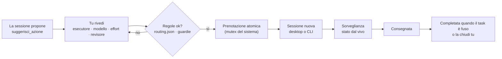
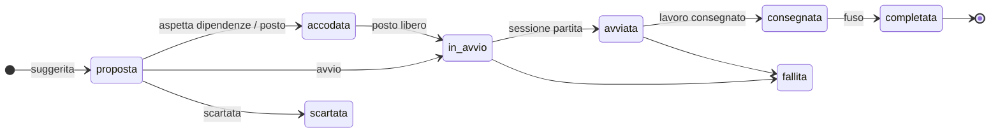

<div align="center">

[English](README.md) · **Italiano**


[](#installazione)
[](#)
[](#immagini)
[](#collaudo)
[](LICENSE)

**[Perché](#perché)** · **[Funzioni](#funzioni)** · **[Immagini](#immagini)** · **[Installazione](#installazione)** · **[Primi passi](#primi-passi)** · **[Come funziona](#come-funziona)** · **[Configurazione](#configurazione)** · **[Limiti e pesi](#limiti-e-bilanciamento)** · **[FreeLLMAPI](#freellmapi)** · **[Terminale](#terminale)** · **[Sicurezza](#sicurezza-e-guardie)** · **[Domande](#domande)**

</div>

---

## Perché

Lavorando con più sessioni di agenti insieme, la parte difficile non è il codice: è **non perdere il filo**.
Le proposte finiscono sparse come chip nelle chat, ognuna ricopiata a mano in una sessione nuova, e nessuno
ricorda quale sessione sta facendo cosa, quale aspetta una tua risposta e cosa è già stato fuso.

**chipManager** mette tutto il lavoro suggerito in un pannello accanto alla conversazione. Una sessione propone,
tu rivedi e indirizzi — Claude o Codex, quale modello, quale effort, chi rivede — e avvii, una alla volta o tutte
insieme nell'ordine delle dipendenze. Il pannello segue ogni avvio dal vivo e lo toglie quando è arrivato.

La mod è **generica**: dà al modello gli strumenti e i dati (limiti, pesi, fornitori ammessi) ed è il modello a
decidere come usarli nel progetto in cui lavora. Tutto ciò che è proprio di un progetto sta in un file locale.

## Funzioni

- **Una sola coda per il lavoro suggerito** — le sessioni chiamano `suggerisci_azione` invece di scrivere chip.
- **Revisione prima dell'avvio** — ordine, esecutore (Claude / Codex), revisore, modello, effort, corsia (R0–R5),
  contesto fork o nuovo, worktree, ramo, permessi. Tutto pre-impostato da chi propone, tutto modificabile.
- **Avvio massivo nell'ordine giusto** — prima le dipendenze, un tetto di sessioni in parallelo, una sola corsia
  Codex per macchina.
- **Chi fa cosa, adesso** — la prima vista mette in tabella tutte le sessioni del progetto, anche quelle aperte a mano
  e quelle Codex: lavoro, motore, modello, effort, stato, contesto usato e ultima attività. Sopra, una riga di
  sintesi («3 al lavoro · 1 aspetta te · Claude 49% · Codex 41%»); sotto, aspettano te · da avviare e in coda · da
  fondere, con avviso al primo blocco.
- **Limiti degli agenti a colpo d'occhio** — piano Claude, piano Codex, spesa API, saldi e budget manuali, ognuno
  con **fonte ed età**. Ignoto vuol dire ignoto: nessun numero inventato.
- **Pesi di carico** — aumenta un fornitore, un modello o un effort in percentuale o in assoluto; il pannello
  sceglie sempre e solo fra le combinazioni che le tue regole ammettono.
- **FreeLLMAPI, su richiesta** — installazione Docker guidata di una versione fissata, rilevamento automatico e
  livelli d'uso per sgravare i compiti testuali brevi e a basso impatto.
- **Desktop e terminale** — lo stesso pannello nell'app Claude Code e nella CLI, con un lanciatore da terminale
  dove il servizio delle sessioni desktop non c'è.
- **Avanzamento delle milestone** — milestone GitHub aperte con percentuale e stima d'arrivo dal ritmo recente.
- **Guardie che falliscono chiuse** — il lavoro sensibile è sempre rivisto da Claude, una prenotazione atomica
  impedisce gli avvii doppi, le regole si rileggono prima di ogni decisione, i segreti non stanno mai in chiaro.

## Immagini

<p align="center"><br><sub><b>In movimento.</b> Una sessione suggerisce tre azioni; un solo avvio le lancia nell'ordine delle dipendenze, e ogni scheda esce dal pannello una volta fusa. Illustrazione con dati d'esempio.</sub></p>

<table>
<tr>
<td width="50%" valign="top"><br><sub><b>App desktop — il pannello.</b> Limiti con fonte ed età, quattro azioni suggerite: una dipendenza che aspetta la fusione, un'azione sensibile (R4) riservata a Claude, la milestone del rilascio in fondo.</sub></td>
<td width="50%" valign="top"><br><sub><b>Impostazioni e pesi.</b> Politica dei fornitori per progetto, chiavi mostrate solo come impostata / mancante, i passi d'installazione di FreeLLMAPI con i comandi completi, e i pesi di carico (qui Codex +50%).</sub></td>
</tr>
<tr>
<td colspan="2" align="center"><br><sub><b>Terminale — screenshot reale.</b> Lo stesso pannello in Claude Code da riga di comando, con il lanciatore CLI.</sub></td>
</tr>
</table>

<sub>Dati d'esempio. Le immagini desktop riproducono contenuto e colori reali del pannello; quella del terminale è una cattura reale.</sub>

## Installazione

Al prompt di una sessione Claude Code nel terminale:

```bash
/plugin install chip-manager --marketplace Elite9400/chipManager
```

Da una shell:

```bash
claude plugin install chip-manager --marketplace Elite9400/chipManager
```

Nell'app desktop, dove `/plugin` non è disponibile: **+** accanto al campo del prompt → **Plugins** →
**Add marketplace** con `Elite9400/chipManager` → **Add plugin**. Un plugin installato dal terminale a livello
utente compare anche nelle sessioni dell'app desktop.

<details>
<summary>Da una cartella locale (sviluppo)</summary>

```bash
claude plugin marketplace add <cartella di chipManager>
```

```bash
claude plugin install chip-manager@chipmanager --scope user
```

L'installazione da cartella legge dalla cartella: non spostarla. Dopo una modifica
`claude plugin marketplace update chipmanager`; le sessioni aperte la ricaricano al riavvio.

</details>

## Primi passi

1. **Installa** la mod (sopra) e apri una sessione in un repository git. Il pannello si apre da solo;
   `/chipmanager` lo riapre.
2. **Dagli le regole**: metti un `routing.json` nel repo (predefinito `.claude/routing.json`, vedi
   [Configurazione](#configurazione)). Senza regole il pannello mostra tutto ma non avvia niente.
3. **Chiedi al modello** di pianificare nel pannello: *«Dividi il lavoro in azioni e suggeriscile in chipManager»*.
   Chiama `suggerisci_azione` una volta per azione, con le dipendenze, e può leggere prima `risorse_agenti`.
4. **Rivedi e avvia**: apri **Dettagli** su una riga per cambiare ciò che vuoi, poi **Avvia** o **Avvia tutte**.

Il pannello ha tre viste: **Lavoro** (chi fa cosa, la coda, quello che aspetta te), **Carico** (limiti e budget) e
**Impostazioni**. I tasti `1` `2` `3` le scelgono anche da tastiera.

## Come funziona



Ogni azione ha un solo ciclo di vita:



### Strumenti MCP

| Strumento | Per | Che cosa fa |
|---|---|---|
| `suggerisci_azione` | il modello che propone | mette un'azione nel pannello con titolo, mandato autoportante, ordine, dipendenze e pre-impostazioni |
| `risorse_agenti` | il modello che propone | sola lettura: limiti con fonte ed età, pesi, fornitori ammessi, livello FreeLLMAPI, modelli ed effort ammessi; delle chiavi solo impostata / mancante |
| `aggiorna_azione` | le sessioni avviate | segna l'azione *consegnata* (o *fallita*) con il gettone di tentativo scritto nel mandato |

## Configurazione

Tutto ciò che è proprio di un progetto sta in un file locale, fuori da ogni repository:
`~/.claude/chipmanager/config.json` (`CHIPMANAGER_CONFIG` per spostarlo). Senza file valgono i valori generici.

```json
{
  "progetti": {
    "owner/repo": {
      "cartella": "~/.claude/chipmanager/progetti/owner__repo",
      "routing": ".claude/routing.json",
      "sensibili": ["anagrafica", "gestione[ _-]?paghe"],
      "background": "Webapp interna: segui CLAUDE.md, lavora nel worktree, riferisci al coordinatore.",
      "fornitori": ["claude", "codex"],
      "soloLocale": false,
      "milestoneGithub": true,
      "freellmapi": { "livello": "niente", "endpoint": "http://localhost:3001/v1" },
      "pesi": [
        { "tipo": "modello", "nome": "gpt-6-astra", "percentuale": 30, "assoluto": 0 },
        { "tipo": "effort", "nome": "high", "percentuale": 10, "assoluto": 0 }
      ],
      "limitiManuali": [
        { "id": "budget-api", "fornitore": "claude", "nome": "Budget API", "valore": 200, "unita": "EUR", "letto": "2026-11-05T08:00:00Z" }
      ],
      "soglie": { "claude": { "attenzione": 70, "critica": 90 }, "codex": { "attenzione": 80, "critica": 95 } }
    }
  }
}
```

| Campo | Che cosa | Predefinito |
|---|---|---|
| `cartella` | dati del progetto (`azioni/`) e registro dell'orchestratore facoltativo (`registro.json`). Ogni progetto ha la sua; `CHIPMANAGER_DIR` vince su tutto, una `cartella` globale (fuori da `progetti`) vale ancora per compatibilità | `~/.claude/chipmanager/progetti/<owner>__<repo>` |
| `routing` | percorso **relativo alla radice del repo** del `routing.json`: modelli, effort, revisori, corsia Codex | `.claude/routing.json` |
| `sensibili` | espressioni regolari che rendono sensibile (R4) un'azione, oltre ad auth / login / password / permessi / PII | nessuna |
| `background` | contesto fisso del mandato locale (il cloud riceve sempre quello generico) | testo generico |
| `fornitori` | `claude`, `codex`, `deepseek`, `freellmapi`; vale anche per il revisore | solo Claude e Codex |
| `soloLocale` | vieta ogni nuovo avvio LLM e ogni sonda esterna della mod, proxy locale incluso | `false` |
| `milestoneGithub` | autorizza `gh api` per le milestone; `soloLocale` lo disabilita comunque | `false` |
| `freellmapi` | livello `niente`, `R1` (R0–R1), `R2` (R0–R2); endpoint HTTP loopback con porta esplicita e `/v1` | spento, localhost:3001 |
| `pesi` | incremento percentuale e/o assoluto per fornitore, modello o effort | nessuno |
| `limitiManuali` | piani, budget o percentuali che dichiari tu, con istante originale e unità | nessuno |
| `soglie` | per fornitore, `attenzione` e `critica` in percentuale (la prima sotto la seconda); `null` = nessuna soglia | 70 / 90 |

Configurazione e `routing.json` si rileggono prima di ogni decisione: se uno dei due è illeggibile o non valido
non parte niente e il pannello dice perché. Le impostazioni si modificano anche dalla vista **Impostazioni**; il
salvataggio è un compare-and-swap sul file intero, preserva gli altri progetti e rifiuta un editor diventato vecchio.

Le azioni salvate da una versione precedente senza progetto non si vedono in nessun progetto. All'apertura, una volta
per sessione, un popup chiede se assegnarle al progetto corrente o scartarle (lo scarto si annulla); se il popup non
si può mostrare, la stessa richiesta resta in cima alla vista Lavoro. Chi passa dalla 2.1 con una `cartella` globale
la sposti nella sezione del progetto che la usa: gli altri progetti avranno così la loro.

<details>
<summary>Forma del <code>routing.json</code></summary>

```json
{
  "modelli_ammessi": ["claude-opus-5-5", "claude-sonnet-5-5", "gpt-6.1-sol", "gpt-6-astra"],
  "effort_ammessi": ["low", "medium", "high", "xhigh"],
  "tetto_per_modello": { "claude-fable-5-1": "xhigh" },
  "revisione": {
    "revisori_ammessi_per_autore": {
      "claude-opus-5-5": ["claude-fable-5-1", "motore:codex"],
      "gpt-6-astra": ["claude-sonnet-5-5", "claude-opus-5-5"]
    }
  },
  "corsia_codex": {
    "modelli": ["gpt-6.1-sol", "gpt-6-astra"],
    "esegue": { "corsie": ["R1", "R2", "R3"] },
    "effort": { "R1": "high", "R2": "xhigh", "R3": "xhigh", "revisione": "xhigh" },
    "rivisto_da": { "R1": "claude-sonnet-5-5", "R2": "claude-sonnet-5-5", "R3": "claude-opus-5-5" }
  }
}
```

Un file parziale non conta come letto: al pannello servono tutte le sezioni che applica.

</details>

## Limiti e bilanciamento

La vista **Carico** risponde a «quale modello fa cosa, con quale effort, e quanto ne resta»: una matrice modello ×
effort (sessioni al lavoro in inchiostro, chip in coda in grigio), i limiti raggruppati per fornitore con una barra al
rapporto vero e i due estremi, il contesto usato da ogni sessione al lavoro con il totale di token per modello, e i
pesi in uso detti a parole con gli avvii delle ultime 24 ore per fornitore.

Ogni riga mostra **fonte, età e unità**. Le barre diventano ambra alla soglia di attenzione e rosse alla critica del
loro fornitore (predefinite 70% e 90%, `soglie` nella configurazione). Dopo cinque minuti, dopo
il reset o in caso d'errore, un valore misurato non è più capacità fresca. I valori manuali dicono quando li hai
inseriti e non contano mai come margine automatico. *Non disponibile* non vuol dire zero uso.

Le viste operative mostrano solo ciò che è configurato: un fornitore compare in **Carico** e nella riga di sintesi
solo se il progetto lo ammette e ha una misura (anche vecchia) o un limite manuale. Una misura vecchia resta come riga
grigia con l'età e senza barra, e la riga di sintesi dice da quanto i limiti non sono letti. I fornitori mai misurati,
o che riportano solo un errore, compaiono solo in **Impostazioni**; se non ne resta nessuno, **Carico** dice
*Nessun limite collegato* e rimanda lì.

| Fonte | Che cosa legge davvero | Attenzione |
|---|---|---|
| Desktop `ccd_session_mgmt.get_usage` | ogni finestra del piano (5 ore, settimanale, settimanale per modello) e l'uso extra se attivo; vecchio formato `five_hour` / `seven_day` | altri formati restano *non disponibili*; un piano non applicabile o non leggibile lo dice con il motivo |
| Status line di Claude CLI | snapshot numerico di `rate_limits` | serve il collegamento d'una riga qui sotto |
| Codex `~/.codex/sessions` | ultimi eventi `token_count` → `rate_limits` | al massimo 30 file, 512 KiB di coda ciascuno; conta l'istante dell'evento |
| DeepSeek `GET /user/balance` | saldo in USD o CNY | nessuna percentuale d'uso |
| Anthropic Admin `cost_report` | spesa del mese UTC in USD | endpoint legacy, serve una chiave Admin |
| FreeLLMAPI `GET /v1/usage` | richieste del mese | non è la quota gratuita residua |

Sonde HTTP: 4 s di timeout, niente redirect, risposta al massimo di 512 KiB, mai testo del progetto. Aggiornate
all'apertura, ogni cinque minuti e con **Aggiorna**. Per la status line di Claude CLI, passa il suo JSON dal tuo
script di status line:

```bash
node /percorso/chipManager/strumenti/fornitori.cjs statusline
```

Scrive soltanto istante e finestre numeriche in `~/.claude/chipmanager/statusline.json`.

**Pesi.** Ognuno parte da 100: `100 × (1 + percentuale / 100) + assoluto`, minimo zero. I fattori di fornitore,
modello ed effort si moltiplicano, poi il risultato si scala sul margine fresco e si divide per `1 + azioni attive
sullo stesso modello` (capacità ignota = 0,25). Il pannello completa **solo i campi che chi propone ha lasciato
vuoti**, e solo con candidati che superano tutte le guardie. Senza pesi l'avvio massivo segue il tuo ordine; con
almeno un peso segue il punteggio, e a parità il tuo ordine. Dipendenze, revisori, effort minimo e mutex vincono
sempre.

**Soglie.** Oltre la soglia critica di un fornitore il suo margine scende a un millesimo: le scelte lasciate aperte
vanno a un altro fornitore ammesso, se c'è (se sono tutti oltre, i margini li ordinano ancora); quelle esplicite
restano. Un limite manuale oltre soglia si segnala come dichiarazione e non cambia le scelte. La riga di sintesi lo dice, e **Avvia tutte** lo scrive
nella conferma e chiede «Avvia comunque». Chiudere la conferma senza scegliere non avvia niente.

## FreeLLMAPI

[FreeLLMAPI](https://github.com/tashfeenahmed/freellmapi) è un proxy da installare in locale, licenza MIT, che
mette i piani gratuiti di molti fornitori dietro un unico indirizzo compatibile OpenAI. chipManager può
installarlo, rilevarlo e usarlo per sgravare i compiti testuali brevi e a basso impatto.

1. **Abilitalo per progetto**: aggiungi `freellmapi` ai fornitori del progetto e scegli il livello. Inoltra il
   testo ai fornitori configurati nel proxy: *localhost non rende locale l'inferenza*.
2. **Rilevamento**: **Aggiorna** sonda l'indirizzo loopback (`/api/ping`, e `/v1/usage` con la chiave).
3. **Installazione** (se manca): **Prepara immagine Docker…** e **Avvia container…** mostrano il comando completo e
   chiedono conferma, separatamente. Sorgente fissato al commit
   [`fb07845`](https://github.com/tashfeenahmed/freellmapi/tree/fb07845faf7cf986ea9f3692e055076035dd8739);
   container con UID 1000, senza capability, porta solo su 127.0.0.1, volume nominato. Docker deve esserci già;
   niente installazioni globali.
4. **Configura** fornitori e chiave unificata nel suo dashboard. Tieni attivo *Model unification*: prima di ogni
   richiesta la mod verifica che il modello sia un gruppo unificato (`owned_by: freellmapi`); `auto`, `fusion` e
   gli alias Claude sono rifiutati.
5. **Ammetti i modelli** aggiungendo `"freellmapi": { "modelli": ["<id del catalogo>"] }` e una riga di revisione
   al `routing.json`.

Le azioni FreeLLMAPI sono trasformazioni testuali brevi a effort `low`: titolo + mandato entro 1500 caratteri,
confermati per intero. Non ricevono mai background, repository, strumenti o file; corsie sensibili, dati locali,
fork e cartelle condivise sono bloccati. Il risultato è una **bozza**, mai applicata da sola, e serve la revisione
di Claude. *Gratis* non è una promessa di costo zero: limiti e fatturazione dipendono dai fornitori del proxy.

## Terminale

Lo stesso pannello e gli stessi tasti funzionano nella CLI: `1` `2` `3` le viste, `r` aggiorna, `a` avvia tutte. Sotto
gli 80 caratteri la tabella delle sessioni lascia cadere contesto e attività e unisce modello ed effort. La
capacità d'avvio si verifica con `tool.list` **prima** di prenotare: dove c'è `start_session` si usa l'app desktop,
altrove il lanciatore CLI. Una risposta desktop persa non diventa mai un secondo avvio.

Il lanciatore CLI vuole `node`, `git` e `claude` sul PATH (`codex` per le azioni Codex). Crea un worktree proprio in
`<repo>/.claude/worktrees/chipmanager-<tentativo>` sul ramo `chipmanager/<tentativo>` e lancia `claude -p` con
modello, effort e permessi espliciti, prompt su stdin, senza shell. Permessi: `default`, `acceptEdits`
(predefinito sulle sensibili) o `plan`; `auto` e bypass sono rifiutati, quindi i comandi che chiedono
un'approvazione fuori dalla tua lista si fermano — controlla il worktree. Dalla CLI niente fork, cloud o cartella
condivisa. Un record per tentativo nasce prima del processo; l'uscita del processo vuol dire *consegnata*, mai
*fusa*. I worktree non vengono mai eliminati da soli.

## Sicurezza e guardie

- **Lavoro sensibile (R4/R5)** — testo che tocca auth, permessi, PII o i tuoi termini configurati: autore Opus o
  Fable, revisore Claude obbligatorio, effort almeno high; mai Codex, proxy, cloud o bypass dei permessi.
- **Un solo avvio** — prenotazione atomica sotto un mutex del sistema operativo (un socket su 127.0.0.1 liberato
  alla morte del processo): due pannelli non avviano mai la stessa azione.
- **Una sola corsia Codex** — occupata finché vive il comando Codex o un suo discendente; le revisioni in attesa
  passano davanti e provano di essere vive con un battito ogni 2 s.
- **Cloud** — solo titolo e mandato, mai il background, mai su corsie sensibili o con dati locali.
- **Chiusura** — solo dal task del registro legato per ramo **e** issue, mai in cartella condivisa; altrimenti
  l'azione resta *consegnata* finché non la chiudi tu.
- **Segreti** — le chiavi Anthropic Admin, DeepSeek e FreeLLMAPI stanno nei campi `userConfig` sicuri di Claude
  Code (`/config`) o nell'ambiente (`ANTHROPIC_ADMIN_KEY`, `DEEPSEEK_API_KEY`, `FREELLMAPI_KEY`). Arrivano
  all'helper solo nel suo ambiente, mai negli argomenti; stato, pannello e messaggi dicono solo *impostata* /
  *mancante*.
- **Fallire chiusi** — regole, configurazione o file d'azione illeggibili bloccano avvii e chiusure automatiche
  invece di tirare a indovinare.

## Struttura

| Percorso | Che cosa |
|---|---|
| `hooks/register.tsx` | eventi, strumenti MCP, avvio delle sessioni, sorveglianza |
| `hooks/pannello.tsx` | il pannello, desktop e terminale |
| `hooks/logica.ts` | logica pura: regole, pianificazione, transizioni, pesi, colori |
| `hooks/risorse.ts`, `strumenti/fornitori.cjs` | fonti dei limiti, trasporto limitato, installazione guidata, proxy testuale |
| `strumenti/disco.cjs` | helper Node: mutex del sistema, compare-and-swap, corsia Codex, lanciatore CLI |
| `types/index.d.ts` | contratto dei tipi e dello stato |
| `docs/ANALISI-2.0.md` | analisi avversaria e design della 2.0 |

## Collaudo

```bash
claude plugin validate .
```

```bash
claude plugin test .
```

```bash
node --test strumenti/prova-disco.cjs
```

83 test del modulo su un motore finto (due superfici, politica, pesi, conferme, segreti, CLI, sessioni) e 27 test
dell'helper con processi veri per mutex, prenotazione e corsia Codex. Nessuna chiamata HTTP reale nei test.

## Domande

<details><summary><b>Manda il mio codice da qualche parte?</b></summary>

La mod di suo non manda testo del progetto: le sonde dei limiti portano solo le credenziali e tornano solo numeri.
Le sessioni che avvii lavorano con Claude o Codex come sempre; i fornitori terzi (DeepSeek, FreeLLMAPI) non
ricevono niente finché non li abiliti per quel progetto, e poi solo titolo e mandato confermati. `soloLocale`
spegne ogni effetto esterno della mod.
</details>

<details><summary><b>Serve il registro dell'orchestratore?</b></summary>

No. Senza, le azioni si fermano a *consegnata* e le chiudi tu con **Segna completata**.
</details>

<details><summary><b>Funziona senza l'app desktop?</b></summary>

Sì: nel terminale usa il lanciatore CLI descritto in [Terminale](#terminale).
</details>

## Licenza

[MIT](LICENSE) © 2026 Cristian TATTINI.
