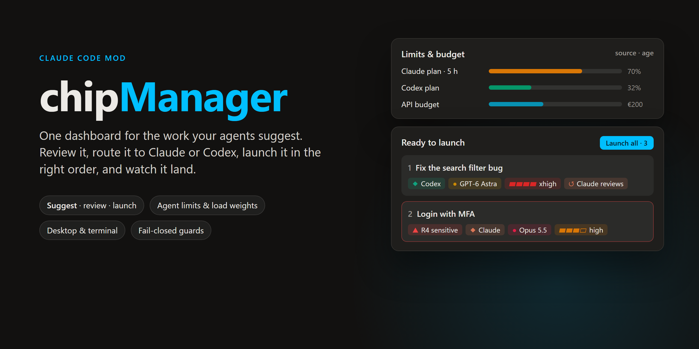
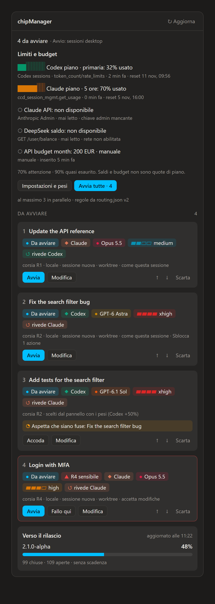
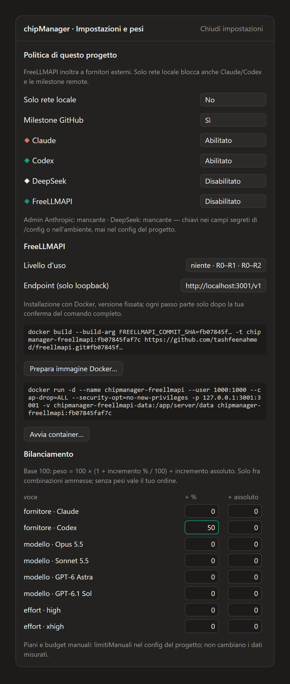
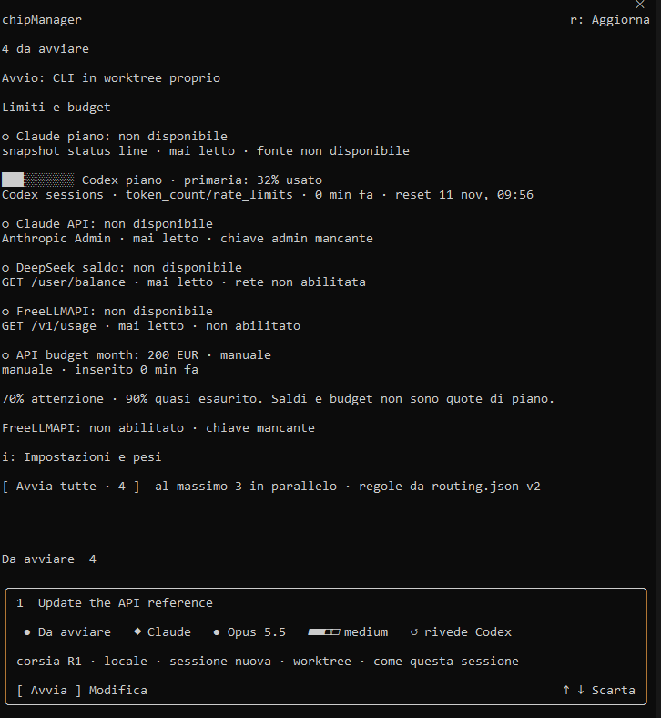
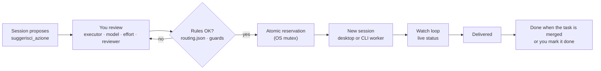
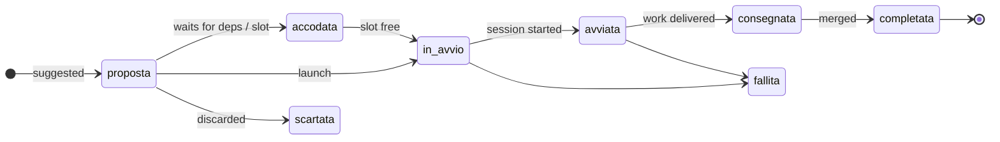

<div align="center">

**English** · [Italiano](README.it.md)



[](#install)
[](#)
[](#screenshots)
[](#testing)
[](LICENSE)

**[Why](#why)** · **[Features](#features)** · **[Screenshots](#screenshots)** · **[Install](#install)** · **[Quick start](#quick-start)** · **[How it works](#how-it-works)** · **[Configuration](#configuration)** · **[Limits & balancing](#limits--load-balancing)** · **[FreeLLMAPI](#freellmapi)** · **[Terminal](#terminal)** · **[Security](#security--guards)** · **[FAQ](#faq)**

</div>

---

## Why

Working with several agent sessions at once, the hardest part is not the code: it is **keeping track**.
Proposals end up scattered as chips across chats, each one copied by hand into a new session, and nobody
remembers which session is doing what, which one is waiting for you, and what is already merged.

**chipManager** puts every suggested piece of work in one panel beside the conversation. A session proposes,
you review and route it — Claude or Codex, which model, which effort, who reviews — and launch it, one at a
time or all together in dependency order. The panel follows each launch live and clears it once it lands.

The mod is **generic**: it gives the model the tools and the data (limits, weights, allowed providers), and the
model decides how to use them for the project at hand. Everything project-specific lives in a local config file.

## Features

- **One queue for suggested work** — sessions call `suggerisci_azione` instead of writing chips in chat.
- **Review before launch** — order, executor (Claude / Codex), reviewer, model, effort, lane (R0–R5), fork or
  fresh context, worktree, branch, permissions. Everything pre-set by the proposer, everything editable.
- **Bulk launch in the right order** — dependencies first, a cap on parallel sessions, one Codex lane per machine.
- **Live status** — waiting for you · running · delivered · queued · ready, with a notice on the first stall.
- **Agent limits at a glance** — Claude plan, Codex plan, API spend, balances and manual budgets, each with
  **source and age**. Unknown means unknown: no invented numbers.
- **Load weights** — boost a provider, a model or an effort level by a percentage or an absolute amount; the
  panel only ever chooses among combinations your rules allow.
- **FreeLLMAPI, opt-in** — guided Docker install of a pinned version, auto-detection, and usage levels to offload
  short, low-impact text tasks.
- **Desktop and terminal** — the same panel in the Claude Code app and in the CLI, with a CLI launcher where the
  desktop session service is not available.
- **Milestone progress** — open GitHub milestones with percentage and an ETA from the recent closing pace.
- **Fail-closed guards** — sensitive work always reviewed by Claude, an atomic reservation so nothing launches
  twice, rules re-read before every decision, secrets never stored in plain text.

## Screenshots

<table>
<tr>
<td width="50%" valign="top"><br><sub><b>Desktop app — the panel.</b> Limits with source and age, four suggested actions: a dependency waiting to be merged, a sensitive (R4) action locked to Claude, the release milestone at the bottom.</sub></td>
<td width="50%" valign="top"><br><sub><b>Settings & weights.</b> Per-project provider policy, keys shown only as set / missing, FreeLLMAPI install steps with the full commands, and load weights (here Codex +50%).</sub></td>
</tr>
<tr>
<td colspan="2" align="center"><br><sub><b>Terminal — real screenshot.</b> The same panel in Claude Code CLI, launching through the CLI worker.</sub></td>
</tr>
</table>

<sub>Demo data. The desktop images render the panel's real content and colours; the terminal image is a real capture. The panel UI is in Italian.</sub>

## Install

At the prompt of a Claude Code terminal session:

```bash
/plugin install chipManager --marketplace Elite9400/chipManager
```

From a shell:

```bash
claude plugin install chipManager --marketplace Elite9400/chipManager
```

In the desktop app, where `/plugin` is not available: **+** next to the prompt box → **Plugins** →
**Add marketplace** with `Elite9400/chipManager` → **Add plugin**. A plugin installed from the terminal at user
scope also shows up in desktop sessions.

<details>
<summary>From a local folder (development)</summary>

```bash
claude plugin marketplace add <path to chipManager>
```

```bash
claude plugin install chipManager@chipmanager --scope user
```

A folder install reads from the folder: do not move it. After a change run
`claude plugin marketplace update chipmanager`; open sessions pick it up on restart.

</details>

## Quick start

1. **Install** the mod (above) and open a session in a git repository. The panel opens on its own; `/chipmanager`
   reopens it.
2. **Give it rules**: put a `routing.json` in the repo (default `.claude/routing.json`, see
   [Configuration](#configuration)). Without rules the panel shows everything but launches nothing.
3. **Ask the model** to plan the work into the panel: *"Split this into actions and suggest them in chipManager"*.
   It calls `suggerisci_azione` once per action, with dependencies, and can read `risorse_agenti` first.
4. **Review and launch**: edit what you want on each card, then **Avvia** (launch) or **Avvia tutte** (launch all).

## How it works



Every action has one lifecycle:



### MCP tools

| Tool | For | What it does |
|---|---|---|
| `suggerisci_azione` | the proposing model | puts an action in the panel with title, self-contained brief, order, dependencies and any preset |
| `risorse_agenti` | the proposing model | read-only: limits with source and age, weights, allowed providers, FreeLLMAPI level, allowed models and efforts; keys only as set / missing |
| `aggiorna_azione` | launched sessions | marks the action *delivered* (or *failed*) with the attempt token written in its brief |

## Configuration

Everything that belongs to a project lives in a local file outside any repository:
`~/.claude/chipmanager/config.json` (`CHIPMANAGER_CONFIG` to move it). Without it, generic defaults apply.

```json
{
  "cartella": "~/.claude/chipmanager",
  "progetti": {
    "owner/repo": {
      "routing": ".claude/routing.json",
      "sensibili": ["payroll", "medical[ _-]?records"],
      "background": "Internal web app: follow CLAUDE.md, work in your worktree, report to the coordinator.",
      "fornitori": ["claude", "codex"],
      "soloLocale": false,
      "milestoneGithub": true,
      "freellmapi": { "livello": "niente", "endpoint": "http://localhost:3001/v1" },
      "pesi": [
        { "tipo": "modello", "nome": "gpt-6-astra", "percentuale": 30, "assoluto": 0 },
        { "tipo": "effort", "nome": "high", "percentuale": 10, "assoluto": 0 }
      ],
      "limitiManuali": [
        { "id": "api-budget", "fornitore": "claude", "nome": "API budget", "valore": 200, "unita": "EUR", "letto": "2026-11-05T08:00:00Z" }
      ]
    }
  }
}
```

| Field | Meaning | Default |
|---|---|---|
| `cartella` | panel data (`azioni/`) and the optional orchestrator registry (`registro.json`); `CHIPMANAGER_DIR` wins | `~/.claude/chipmanager` |
| `routing` | path **relative to the repo root** of `routing.json`: models, efforts, reviewers, Codex lane | `.claude/routing.json` |
| `sensibili` | regular expressions that make an action sensitive (R4), on top of auth / login / password / permissions / PII | none |
| `background` | fixed context for local briefs (the cloud always gets the generic one) | generic text |
| `fornitori` | `claude`, `codex`, `deepseek`, `freellmapi`; applies to the reviewer too | Claude and Codex only |
| `soloLocale` | blocks every new LLM launch and every external probe of the mod, local proxy included | `false` |
| `milestoneGithub` | allows `gh api` for milestones; `soloLocale` disables it anyway | `false` |
| `freellmapi` | level `niente`, `R1` (R0–R1), `R2` (R0–R2); loopback HTTP endpoint with explicit port and `/v1` | off, localhost:3001 |
| `pesi` | percentage and/or absolute boost per provider, model or effort | none |
| `limitiManuali` | plans, budgets or percentages you declare, with original time and unit | none |

Config and `routing.json` are re-read before every decision: if either is unreadable or invalid, nothing
launches and the panel says why. Settings can also be edited from **Impostazioni e pesi**; saving is a
compare-and-swap on the whole file, keeps other projects intact and refuses a stale editor.

<details>
<summary><code>routing.json</code> shape</summary>

```json
{
  "modelli_ammessi": ["claude-opus-5-5", "claude-sonnet-5-5", "gpt-6.1-sol", "gpt-6-astra"],
  "effort_ammessi": ["low", "medium", "high", "xhigh"],
  "tetto_per_modello": { "claude-fable-5-1": "xhigh" },
  "revisione": {
    "revisori_ammessi_per_autore": {
      "claude-opus-5-5": ["claude-fable-5-1", "motore:codex"],
      "gpt-6-astra": ["claude-sonnet-5-5", "claude-opus-5-5"]
    }
  },
  "corsia_codex": {
    "modelli": ["gpt-6.1-sol", "gpt-6-astra"],
    "esegue": { "corsie": ["R1", "R2", "R3"] },
    "effort": { "R1": "high", "R2": "xhigh", "R3": "xhigh", "revisione": "xhigh" },
    "rivisto_da": { "R1": "claude-sonnet-5-5", "R2": "claude-sonnet-5-5", "R3": "claude-opus-5-5" }
  }
}
```

A partial file does not count as read: the panel needs every section it enforces.

</details>

## Limits & load balancing

Each row shows **source, age and unit**. Bars turn amber at 70% and red at 90%. After five minutes, after the
reset or on error, a measured value is no longer fresh capacity. Manual values say when you entered them and never
count as automatic margin. *Not available* never means zero usage.

| Source | What it really reads | Caveats |
|---|---|---|
| Desktop `ccd_session_mgmt.get_usage` | `five_hour` / `seven_day` windows | other formats stay *not available* |
| Claude CLI status line | numeric `rate_limits` snapshot | needs the one-line hook below |
| Codex `~/.codex/sessions` | latest `token_count` → `rate_limits` events | at most 30 files, 512 KiB tail each; event time, not file time |
| DeepSeek `GET /user/balance` | balance in USD or CNY | no usage percentage |
| Anthropic Admin `cost_report` | current UTC month spend in USD | legacy endpoint, needs an Admin key |
| FreeLLMAPI `GET /v1/usage` | requests this month | not the remaining free quota |

HTTP probes: 4 s timeout, no redirects, 512 KiB cap, no project text ever sent. Refreshed on open, every five
minutes and with **Aggiorna**. To feed the Claude CLI status line, pipe its JSON from your own status-line script:

```bash
node /path/to/chipManager/strumenti/fornitori.cjs statusline
```

It writes only the time and the numeric windows to `~/.claude/chipmanager/statusline.json`.

**Weights.** Each starts at 100: `100 × (1 + percent / 100) + absolute`, floor zero. Provider, model and effort
factors multiply, then the result is scaled by fresh margin and divided by `1 + active actions on the same
model` (unknown capacity counts as 0.25). The panel fills **only the fields the proposer left out**, and only
with candidates that pass every guard. With no weights configured, bulk launch follows your manual order; with
at least one weight it follows the score, ties keeping your order. Dependencies, reviewers, minimum effort and the
mutex always win.

## FreeLLMAPI

[FreeLLMAPI](https://github.com/tashfeenahmed/freellmapi) is a self-hosted, MIT-licensed proxy that puts many
free LLM tiers behind one OpenAI-compatible endpoint. chipManager can install it, detect it and use it to offload
short, low-impact text tasks.

1. **Opt in per project**: add `freellmapi` to the project's providers and pick a level. It forwards text to the
   providers configured in the proxy: *localhost does not make inference local*.
2. **Detect**: **Aggiorna** probes the loopback endpoint (`/api/ping`, and `/v1/usage` with a key).
3. **Install** (if missing): **Prepara immagine Docker…** and **Avvia container…** show the full command and ask for
   confirmation, separately. Source pinned to commit
   [`fb07845`](https://github.com/tashfeenahmed/freellmapi/tree/fb07845faf7cf986ea9f3692e055076035dd8739);
   container as UID 1000, no capabilities, port bound to 127.0.0.1 only, named volume. Docker must already be
   there; nothing is installed globally.
4. **Configure** providers and the unified key in its dashboard. Keep *Model unification* on: before every
   request the mod checks that the model is a unified group (`owned_by: freellmapi`); `auto`, `fusion` and Claude
   aliases are refused.
5. **Allow models** by adding `"freellmapi": { "modelli": ["<catalog id>"] }` and a reviewer row to `routing.json`.

FreeLLMAPI actions are short text transformations at effort `low`: title + brief within 1500 characters,
confirmed in full. They never get background, repository, tools or files; sensitive lanes, local data, forks and
shared folders are blocked. The result is a **draft**, never applied automatically, and a Claude review is
required. *Free* is not a promise of zero cost: limits and billing depend on the proxy's providers.

## Terminal

The same panel and keys work in the CLI: `r` refresh, `i` settings, `a` launch all. Launch capability is checked
with `tool.list` **before** reserving: where `start_session` exists the desktop app is used; elsewhere a CLI
worker. A lost desktop answer never falls back to a second launch.

The CLI worker needs `node`, `git` and `claude` on the PATH (`codex` for Codex actions). It creates its own
worktree in `<repo>/.claude/worktrees/chipmanager-<attempt>` on branch `chipmanager/<attempt>` and runs
`claude -p` with explicit model, effort and permission mode, prompt on stdin, no shell. Permission modes:
`default`, `acceptEdits` (default on sensitive work) or `plan`; `auto` and bypass are refused, so commands that
need approval outside your allow-list stop and wait — check the worktree. No fork, cloud or shared folder from the
CLI. A per-attempt record is written before the spawn; process exit means *delivered*, never *merged*. Worktrees
are never deleted automatically.

## Security & guards

- **Sensitive work (R4/R5)** — text touching auth, permissions, PII or your configured terms: author Opus or Fable,
  Claude reviewer mandatory, effort at least high; never Codex, a proxy, the cloud or a permission bypass.
- **Launch once** — atomic reservation under an operating-system mutex (a socket on 127.0.0.1 released when the
  process dies): two panels never launch the same action.
- **One Codex lane** — held while the Codex command or any descendant lives; waiting reviews go first and prove
  they are alive with a heartbeat every 2 s.
- **Cloud** — only title and brief, never background, never on sensitive lanes or with local-data patterns.
- **Closing** — only from a registry task linked by branch **and** issue, never in a shared folder; otherwise the
  action stays *delivered* until you mark it done.
- **Secrets** — Anthropic Admin, DeepSeek and FreeLLMAPI keys live in Claude Code's secure `userConfig` fields
  (`/config`) or in the environment (`ANTHROPIC_ADMIN_KEY`, `DEEPSEEK_API_KEY`, `FREELLMAPI_KEY`). They reach the
  helper only through its environment, never argv; state, panel and messages show only *set* / *missing*.
- **Fail closed** — unreadable rules, config or action files block launches and auto-closing instead of guessing.

## Project layout

| Path | What |
|---|---|
| `hooks/register.tsx` | events, MCP tools, session launch, watch loop |
| `hooks/pannello.tsx` | the panel, desktop and terminal |
| `hooks/logica.ts` | pure logic: rules, planning, transitions, weights, colours |
| `hooks/risorse.ts`, `strumenti/fornitori.cjs` | limit sources, bounded transport, guided install, text proxy |
| `strumenti/disco.cjs` | Node helper: OS mutex, compare-and-swap, Codex lane, CLI worker |
| `types/index.d.ts` | types and state contract |
| `docs/ANALISI-2.0.md` | adversarial analysis and design of 2.0 (Italian) |

## Testing

```bash
claude plugin validate .
```

```bash
claude plugin test .
```

```bash
node --test strumenti/prova-disco.cjs
```

67 module tests on a fake engine (both surfaces, policy, weights, confirmations, secrets, CLI) and 26 helper tests
with real processes for the mutex, reservation and Codex lane. No real HTTP in tests.

## FAQ

<details><summary><b>Does it send my code anywhere?</b></summary>

The mod itself sends no project text: limit probes carry only credentials and return only numbers. The sessions you
launch work with Claude or Codex as they always do; third-party providers (DeepSeek, FreeLLMAPI) get nothing unless
you enable them for that project, and then only the confirmed title and brief. `soloLocale` turns every external
effect of the mod off.
</details>

<details><summary><b>Why is the UI in Italian?</b></summary>

It was born in an Italian team. Labels are short and the colours and symbols carry the meaning; an English UI is on
the wish list.
</details>

<details><summary><b>Do I need the orchestrator registry?</b></summary>

No. Without it, actions stop at *delivered* and you close them with **Segna completata** (mark done).
</details>

<details><summary><b>Can it run without the desktop app?</b></summary>

Yes: in the terminal it uses the CLI worker described in [Terminal](#terminal).
</details>

## License

[MIT](LICENSE) © 2026 Cristian TATTINI.
