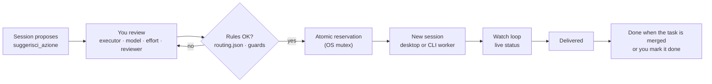
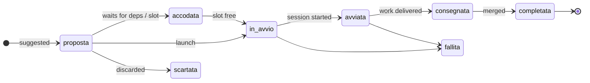

<div align="center">

**English** · [Italiano](README.it.md)


[](#install)
[](#)
[](#screenshots)
[](#testing)
[](LICENSE)

**[Why](#why)** · **[Features](#features)** · **[Screenshots](#screenshots)** · **[Install](#install)** · **[Quick start](#quick-start)** · **[How it works](#how-it-works)** · **[Configuration](#configuration)** · **[Limits & balancing](#limits--load-balancing)** · **[FreeLLMAPI](#freellmapi)** · **[Languages](#languages)** · **[Terminal](#terminal)** · **[Security](#security--guards)** · **[FAQ](#faq)**

</div>

---

## Why

Working with several agent sessions at once, the hardest part is not the code: it is **keeping track**.
Proposals end up scattered as chips across chats, each one copied by hand into a new session, and nobody
remembers which session is doing what, which one is waiting for you, and what is already merged.

**chipManager** puts every suggested piece of work in one panel beside the conversation. A session proposes,
you review and route it — Claude or Codex, which model, which effort, who reviews — and launch it, one at a
time or all together in dependency order. The panel follows each launch live and clears it once it lands.

The mod is **generic**: it gives the model the tools and the data (limits, weights, allowed providers), and the
model decides how to use them for the project at hand. Everything project-specific lives in a local config file.

## Features

- **One queue for suggested work** — sessions call `suggerisci_azione` instead of writing chips in chat.
- **Review before launch** — order, executor (Claude / Codex), reviewer, model, effort, lane (R0–R5), fork or
  fresh context, worktree, branch, permissions. Everything pre-set by the proposer, everything editable.
- **Bulk launch in the right order** — dependencies first, a cap on parallel sessions, one Codex lane per machine.
- **Who is doing what, right now** — the first view lists every session of the project in a table, including the ones
  opened by hand and the Codex ones: work, engine, model, effort, status, context used and last activity. Above it, a
  summary line ("3 al lavoro · 1 aspetta te · Claude 49% · Codex 41%"); below it, waiting for you · ready and queued ·
  to merge, with a notice on the first stall.
- **Agent limits at a glance** — Claude plan, Codex plan, API spend, balances and manual budgets, each with
  **source and age**. Unknown means unknown: no invented numbers.
- **Start one chip easily** — every ready chip has **▶ Start** in the same place, **Start next** (`n`) starts the
  first one the plan would start now, and a blocked chip says why.
- **Responsive on desktop and terminal** — titles wrap, actions move below when space runs out, and the layout
  follows the real pane width on every surface.
- **Settings by section** — Connections, Thresholds, Balancing, Project, Board and Advanced, built from chips and
  `−`/`+` steppers instead of free numbers; every control saves on its own.
- **Load weights** — pick a profile (Automatic, Saving, Quality, Speed) or tune providers, models and effort on a
  five-step scale; the panel only ever chooses among combinations your rules allow.
- **FreeLLMAPI, opt-in** — guided Docker install of a pinned version, auto-detection, and usage levels to offload
  short, low-impact text tasks.
- **Desktop and terminal** — the same panel in the Claude Code app and in the CLI, with a CLI launcher where the
  desktop session service is not available.
- **Milestone progress** — open GitHub milestones with percentage and an ETA from the recent closing pace.
- **Project board, opt-in** — a local HTML page with the line of work and, for each task, plan, brief, process,
  owner, effort and review. Generated without any model; one-sentence summaries by the lightest model are a
  separate opt-in.
- **Fail-closed guards** — sensitive work always reviewed by Claude, an atomic reservation so nothing launches
  twice, rules re-read before every decision, secrets never stored in plain text.

## Screenshots

<p align="center"><br><sub><b>In motion.</b> A session suggests three actions; one launch starts them in dependency order, and each card leaves the panel once merged. Illustration with sample data.</sub></p>

<table>
<tr>
<td width="50%" valign="top"><br><sub><b>Desktop app — the panel.</b> Limits with source and age, four suggested actions: a dependency waiting to be merged, a sensitive (R4) action locked to Claude, the release milestone at the bottom.</sub></td>
<td width="50%" valign="top"><br><sub><b>Settings & weights.</b> Per-project provider policy, keys shown only as set / missing, FreeLLMAPI install steps with the full commands, and load weights (here Codex +50%).</sub></td>
</tr>
<tr>
<td colspan="2" align="center"><br><sub><b>Terminal — real screenshot.</b> The same panel in Claude Code CLI, launching through the CLI worker.</sub></td>
</tr>
</table>

<sub>Demo data. The desktop images render the panel's real content and colours; the terminal image is a real capture. The panel UI is in Italian.</sub>

## Install

At the prompt of a Claude Code terminal session:

```bash
/plugin install chip-manager --marketplace Elite9400/chipManager
```

From a shell:

```bash
claude plugin install chip-manager --marketplace Elite9400/chipManager
```

In the desktop app, where `/plugin` is not available: **+** next to the prompt box → **Plugins** →
**Add marketplace** with `Elite9400/chipManager` → **Add plugin**. A plugin installed from the terminal at user
scope also shows up in desktop sessions.

<details>
<summary>From a local folder (development)</summary>

```bash
claude plugin marketplace add <path to chipManager>
```

```bash
claude plugin install chip-manager@chipmanager --scope user
```

A folder install reads from the folder: do not move it. After a change run
`claude plugin marketplace update chipmanager`; open sessions pick it up on restart.

</details>

## Quick start

1. **Install** the mod (above) and open a session in a git repository. The panel opens on its own; `/chipmanager`
   reopens it.
2. **Give it rules**: put a `routing.json` in the repo (default `.claude/routing.json`, see
   [Configuration](#configuration)). Without rules the panel shows everything but launches nothing.
3. **Ask the model** to plan the work into the panel: *"Split this into actions and suggest them in chipManager"*.
   It calls `suggerisci_azione` once per action, with dependencies, and can read `risorse_agenti` first.
4. **Review and launch**: open **Dettagli** (details) on a row to edit what you want, then **Avvia** (launch) or
   **Avvia tutte** (launch all).

The panel has three views: **Lavoro** (work: who is doing what, the queue, what waits for you), **Carico** (load:
limits and budgets) and **Impostazioni** (settings). Keys `1` `2` `3` switch between them.

## How it works



Every action has one lifecycle:



### MCP tools

| Tool | For | What it does |
|---|---|---|
| `suggerisci_azione` | the proposing model | puts an action in the panel with title, self-contained brief, order, dependencies and any preset |
| `risorse_agenti` | the proposing model | read-only: limits with source and age, weights, allowed providers, FreeLLMAPI level, allowed models and efforts; keys only as set / missing |
| `aggiorna_azione` | launched sessions | marks the action *delivered* (or *failed*) with the attempt token written in its brief; reports the review outcome (`revisione`), also without a state |

## Configuration

Everything that belongs to a project lives in a local file outside any repository:
`~/.claude/chipmanager/config.json` (`CHIPMANAGER_CONFIG` to move it). Without it, generic defaults apply.

```json
{
  "progetti": {
    "owner/repo": {
      "cartella": "~/.claude/chipmanager/progetti/owner__repo",
      "routing": ".claude/routing.json",
      "sensibili": ["payroll", "medical[ _-]?records"],
      "background": "Internal web app: follow CLAUDE.md, work in your worktree, report to the coordinator.",
      "fornitori": ["claude", "codex"],
      "soloLocale": false,
      "milestoneGithub": true,
      "freellmapi": { "livello": "niente", "endpoint": "http://localhost:3001/v1" },
      "pesi": [
        { "tipo": "modello", "nome": "gpt-6-astra", "percentuale": 30, "assoluto": 0 },
        { "tipo": "effort", "nome": "high", "percentuale": 10, "assoluto": 0 }
      ],
      "limitiManuali": [
        { "id": "api-budget", "fornitore": "claude", "nome": "API budget", "valore": 200, "unita": "EUR", "letto": "2026-11-05T08:00:00Z" }
      ],
      "soglie": { "claude": { "attenzione": 70, "critica": 90 }, "codex": { "attenzione": 80, "critica": 95 } }
    }
  }
}
```

| Field | Meaning | Default |
|---|---|---|
| `cartella` | the project's data (`azioni/`) and the optional orchestrator registry (`registro.json`). Each project has its own; `CHIPMANAGER_DIR` wins over everything, and a global `cartella` (outside `progetti`) still applies for compatibility | `~/.claude/chipmanager/progetti/<owner>__<repo>` |
| `routing` | path **relative to the repo root** of `routing.json`: models, efforts, reviewers, Codex lane | `.claude/routing.json` |
| `sensibili` | regular expressions that make an action sensitive (R4), on top of auth / login / password / permissions / PII | none |
| `background` | fixed context for local briefs (the cloud always gets the generic one) | generic text |
| `fornitori` | `claude`, `codex`, `deepseek`, `freellmapi`; applies to the reviewer too | Claude and Codex only |
| `soloLocale` | blocks every new LLM launch and every external probe of the mod, local proxy included | `false` |
| `milestoneGithub` | allows `gh api` for milestones; `soloLocale` disables it anyway | `false` |
| `freellmapi` | level `niente`, `R1` (R0–R1), `R2` (R0–R2); loopback HTTP endpoint with explicit port and `/v1` | off, localhost:3001 |
| `pesi` | percentage and/or absolute boost per provider, model or effort | none |
| `limitiManuali` | plans, budgets or percentages you declare, with original time and unit | none |
| `soglie` | per provider, `attenzione` (warning) and `critica` (critical) as percentages, the first below the second; `null` = no threshold | 70 / 90 |

Config and `routing.json` are re-read before every decision: if either is unreadable or invalid, nothing
launches and the panel says why. Settings can also be edited from the **Impostazioni** view; saving is a
compare-and-swap on the whole file, keeps other projects intact and refuses a stale editor.

Actions saved without a project by an earlier version are not shown in any project. On opening, once per session, a
popup asks whether to assign them to the current project or discard them (discarding can be undone); if the popup
cannot be shown, the same request stays at the top of the Lavoro view. When upgrading from 2.1 with a global
`cartella`, move it into the section of the project that uses it, so the other projects get their own.

<details>
<summary><code>routing.json</code> shape</summary>

```json
{
  "modelli_ammessi": ["claude-opus-5-5", "claude-sonnet-5-5", "gpt-6.1-sol", "gpt-6-astra"],
  "effort_ammessi": ["low", "medium", "high", "xhigh"],
  "tetto_per_modello": { "claude-fable-5-1": "xhigh" },
  "revisione": {
    "revisori_ammessi_per_autore": {
      "claude-opus-5-5": ["claude-fable-5-1", "motore:codex"],
      "gpt-6-astra": ["claude-sonnet-5-5", "claude-opus-5-5"]
    }
  },
  "corsia_codex": {
    "modelli": ["gpt-6.1-sol", "gpt-6-astra"],
    "esegue": { "corsie": ["R1", "R2", "R3"] },
    "effort": { "R1": "high", "R2": "xhigh", "R3": "xhigh", "revisione": "xhigh" },
    "rivisto_da": { "R1": "claude-sonnet-5-5", "R2": "claude-sonnet-5-5", "R3": "claude-opus-5-5" }
  }
}
```

A partial file does not count as read: the panel needs every section it enforces.

</details>

## Project board

Off by default. In **Settings → Board di progetto** choose *Accesa* (on) or *Accesa con riassunti* (on with
summaries). The panel then writes `<data folder>/board/<project>-<hash>/index.html` every 30 seconds when something
changed, and **Open board** in the header opens it in your browser.

- **What it shows** — waiting for you · in progress (with the registry phases) · next (order, dependencies and launch
  blocks) · done (last 30 days and the last 15 commits of the base branch). Each task opens a card with its plan
  (`piano`, a `.md`/`.txt` path in the repository), the brief rebuilt with the current rules, the original brief
  and background, lane and steps, executor, model, effort, permissions, worktree, the expected reviewer and the
  outcome reported by a session ("riferita da", never "verified"), dates and links.
- **Cost** — the page is built by code, zero tokens. Summaries, if you turn them on, cost about 700 input and 120
  output tokens per changed task with `haiku`, at most 5 a minute and 100 a day. They only send title, brief and
  dependency titles to Claude, and never run with *Solo rete locale* or with Claude disabled.
- **Never published** — a local file only. No scripts, no remote resources, no links built from data, a strict
  Content-Security-Policy, attempt tokens masked. It refuses data folders inside a git working tree.

## Limits & load balancing

The **Carico** (load) view answers "which model does what, at which effort, and how much is left": a model × effort
matrix (sessions at work in ink, queued actions in grey), the limits grouped by provider with a bar at the true ratio
and both ends labelled, the context used by each working session with the token total per model, and the weights in
use in plain words with the launches of the last 24 hours per provider.

Each row shows **source, age and unit**. Bars turn amber at the warning threshold and red at the critical threshold
of their provider (70% and 90% by default, `soglie` in the configuration). After five minutes, after the
reset or on error, a measured value is no longer fresh capacity. Manual values say when you entered them and never
count as automatic margin. *Not available* never means zero usage.

The working views show only what is configured: a provider appears in **Carico** and in the summary line only when
the project allows it and it has a measurement (even an old one) or a manual limit. An old measurement stays as a
grey row with its age and no bar, and the summary line says how long ago the limits were read. Providers that were
never measured, or only report an error, appear only in **Impostazioni**, which shows the state of each allowed
provider's reading with its errors; with none left, **Carico** says *Nessun limite collegato* and points there.

| Source | What it really reads | Caveats |
|---|---|---|
| Desktop `ccd_session_mgmt.get_usage` | every plan window (5-hour, weekly, weekly per model) and extra usage when enabled; legacy `five_hour` / `seven_day` | other formats stay *not available*; a plan that does not apply or cannot be read says so, with the reason |
| Claude CLI status line | numeric `rate_limits` snapshot | needs the one-line hook below |
| Codex `~/.codex/sessions` | latest `token_count` → `rate_limits` events | at most 30 files, 512 KiB tail each; event time, not file time |
| DeepSeek `GET /user/balance` | balance in USD or CNY | no usage percentage |
| Anthropic Admin `cost_report` | current UTC month spend in USD | legacy endpoint, needs an Admin key |
| FreeLLMAPI `GET /v1/usage` | requests this month | not the remaining free quota |

HTTP probes: 4 s timeout, no redirects, 512 KiB cap, no project text ever sent. Refreshed on open, every five
minutes and with **Aggiorna**. To feed the Claude CLI status line, pipe its JSON from your own status-line script:

```bash
node /path/to/chipManager/strumenti/fornitori.cjs statusline
```

It writes only the time and the numeric windows to `~/.claude/chipmanager/statusline.json`.

**Weights.** Each starts at 100: `100 × (1 + percent / 100) + absolute`, floor zero. Provider, model and effort
factors multiply, then the result is scaled by fresh margin and divided by `1 + active actions on the same
model` (unknown capacity counts as 0.25). The panel fills **only the fields the proposer left out**, and only
with candidates that pass every guard. With no weights configured, bulk launch follows your manual order; with
at least one weight it follows the score, ties keeping your order. Dependencies, reviewers, minimum effort and the
mutex always win.

**Thresholds.** Above a provider's critical threshold its margin drops to a thousandth: the choices left open go to
another allowed provider, if there is one (when all are above, the margins still rank them); explicit choices stay.
A manual limit above a threshold is flagged as a declaration and does not change the choices. The summary line says so, and **Avvia tutte** (launch all)
writes it in the confirmation and asks "Avvia comunque" (launch anyway). Closing the confirmation without a choice
launches nothing.

## FreeLLMAPI

[FreeLLMAPI](https://github.com/tashfeenahmed/freellmapi) is a self-hosted, MIT-licensed proxy that puts many
free LLM tiers behind one OpenAI-compatible endpoint. chipManager can install it, detect it and use it to offload
short, low-impact text tasks.

1. **Opt in per project**: add `freellmapi` to the project's providers and pick a level. It forwards text to the
   providers configured in the proxy: *localhost does not make inference local*.
2. **Detect**: **Aggiorna** probes the loopback endpoint (`/api/ping`, and `/v1/usage` with a key).
3. **Install** (if missing): **Prepara immagine Docker…** and **Avvia container…** show the full command and ask for
   confirmation, separately. Source pinned to commit
   [`fb07845`](https://github.com/tashfeenahmed/freellmapi/tree/fb07845faf7cf986ea9f3692e055076035dd8739);
   container as UID 1000, no capabilities, port bound to 127.0.0.1 only, named volume. Docker must already be
   there; nothing is installed globally.
4. **Configure** providers and the unified key in its dashboard. Keep *Model unification* on: before every
   request the mod checks that the model is a unified group (`owned_by: freellmapi`); `auto`, `fusion` and Claude
   aliases are refused.
5. **Allow models** by adding `"freellmapi": { "modelli": ["<catalog id>"] }` and a reviewer row to `routing.json`.

FreeLLMAPI actions are short text transformations at effort `low`: title + brief within 1500 characters,
confirmed in full. They never get background, repository, tools or files; sensitive lanes, local data, forks and
shared folders are blocked. The result is a **draft**, never applied automatically, and a Claude review is
required. *Free* is not a promise of zero cost: limits and billing depend on the proxy's providers.

## Languages

The panel, the board, popups and notifications speak six languages:

| Code | Language |
|---|---|
| `en` | English (default) |
| `it` | Italiano |
| `es` | Español |
| `fr` | Français |
| `de` | Deutsch |
| `pt` | Português (Brasil) |

Pick yours in **Settings → Language**. Each language is listed by its own name, so you can find yours from any
of them. The choice belongs to you, not to a project: it is saved as `lingua` at the top level of
`~/.claude/chipmanager/config.json` and applies to every project. A missing, unknown or unreadable value means
English. Other open panels pick up the change within one heartbeat (20 s); the board is rewritten on its next
round, in the same language.

Dates, plurals and decimal separators come from the mod's own dictionaries (`hooks/lingue/`), not from the
runtime, so they look the same everywhere. Budget units can be typed in any of the six languages (`500 requests`,
`500 richieste`, `500 Anfragen`…).

What stays in English: the texts written for agents (tool descriptions, refusals, the brief sent to new sessions)
and the manifest. What is never translated: your own content, such as chip titles and briefs, and names of models,
branches and files.

English and Italian are written by hand. Spanish, French, German and Brazilian Portuguese are machine-translated:
corrections are welcome. The shared terms are in [`hooks/lingue/glossario.md`](hooks/lingue/glossario.md).
Chinese, Japanese and Korean are not available yet: double-width characters need the terminal tables reworked
first. Personal content with emoji or CJK text wraps and truncates as before, without column alignment.

## Terminal

The same panel and keys work in the CLI: `1` `2` `3` the views, `r` refresh, `a` launch all. Below 80 columns the
sessions table drops context and activity and merges model and effort. Launch capability is checked
with `tool.list` **before** reserving: where `start_session` exists the desktop app is used; elsewhere a CLI
worker. A lost desktop answer never falls back to a second launch.

The CLI worker needs `node`, `git` and `claude` on the PATH (`codex` for Codex actions). It creates its own
worktree in `<repo>/.claude/worktrees/chipmanager-<attempt>` on branch `chipmanager/<attempt>` and runs
`claude -p` with explicit model, effort and permission mode, prompt on stdin, no shell. Permission modes:
`default`, `acceptEdits` (default on sensitive work) or `plan`; `auto` and bypass are refused, so commands that
need approval outside your allow-list stop and wait — check the worktree. No fork, cloud or shared folder from the
CLI. A per-attempt record is written before the spawn; process exit means *delivered*, never *merged*. Worktrees
are never deleted automatically.

## Security & guards

- **Sensitive work (R4/R5)** — text touching auth, permissions, PII or your configured terms: author Opus or Fable,
  Claude reviewer mandatory, effort at least high; never Codex, a proxy, the cloud or a permission bypass.
- **Launch once** — atomic reservation under an operating-system mutex (a socket on 127.0.0.1 released when the
  process dies): two panels never launch the same action.
- **One Codex lane** — held while the Codex command or any descendant lives; waiting reviews go first and prove
  they are alive with a heartbeat every 2 s.
- **Cloud** — only title and brief, never background, never on sensitive lanes or with local-data patterns.
- **Closing** — only from a registry task linked by branch **and** issue, never in a shared folder; otherwise the
  action stays *delivered* until you mark it done.
- **Secrets** — Anthropic Admin, DeepSeek and FreeLLMAPI keys live in Claude Code's secure `userConfig` fields
  (`/config`) or in the environment (`ANTHROPIC_ADMIN_KEY`, `DEEPSEEK_API_KEY`, `FREELLMAPI_KEY`). They reach the
  helper only through its environment, never argv; state, panel and messages show only *set* / *missing*.
- **Fail closed** — unreadable rules, config or action files block launches and auto-closing instead of guessing.
- **Board** — written by the helper under the configuration lock, only if mode and generation are still the
  expected ones; links, junctions, foreign identity markers and data folders inside a working tree are refused.

## Project layout

| Path | What |
|---|---|
| `hooks/register.tsx` | events, MCP tools, session launch, watch loop |
| `hooks/pannello.tsx` | the panel, desktop and terminal |
| `hooks/logica.ts` | pure logic: rules, planning, transitions, weights, colours |
| `hooks/board.ts` | pure generator of the project board (HTML) |
| `hooks/lingua.ts`, `hooks/lingue/` | languages: typed dictionaries (English is the source), plurals, dates, numbers, glossary |
| `hooks/risorse.ts`, `strumenti/fornitori.cjs` | limit sources, bounded transport, guided install, text proxy |
| `strumenti/disco.cjs` | Node helper: OS mutex, compare-and-swap, Codex lane, CLI worker, board and plan reading |
| `types/index.d.ts` | types and state contract |
| `docs/ANALISI-2.0.md` | adversarial analysis and design of 2.0 (Italian) |

## Testing

```bash
claude plugin validate .
```

```bash
claude plugin test .
```

```bash
node --test strumenti/prova-disco.cjs
```

83 module tests on a fake engine (both surfaces, policy, weights, confirmations, secrets, CLI, sessions) and 27 helper tests
with real processes for the mutex, reservation and Codex lane. No real HTTP in tests.

## FAQ

<details><summary><b>Does it send my code anywhere?</b></summary>

The mod itself sends no project text: limit probes carry only credentials and return only numbers. The sessions you
launch work with Claude or Codex as they always do; third-party providers (DeepSeek, FreeLLMAPI) get nothing unless
you enable them for that project, and then only the confirmed title and brief. `soloLocale` turns every external
effect of the mod off.
</details>

<details><summary><b>Why is the UI in Italian?</b></summary>

It was born in an Italian team. Labels are short and the colours and symbols carry the meaning; an English UI is on
the wish list.
</details>

<details><summary><b>Do I need the orchestrator registry?</b></summary>

No. Without it, actions stop at *delivered* and you close them with **Segna completata** (mark done).
</details>

<details><summary><b>Can it run without the desktop app?</b></summary>

Yes: in the terminal it uses the CLI worker described in [Terminal](#terminal).
</details>

## License

[MIT](LICENSE) © 2026 Cristian TATTINI.
