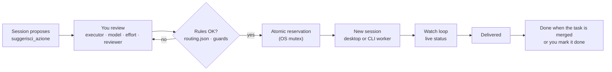
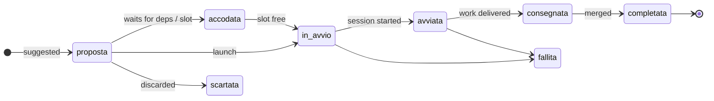

<div align="center">

**English** · [Italiano](README.it.md)


[](#install)
[](#)
[](#screenshots)
[](#testing)
[](LICENSE)

**[Why](#why)** · **[Features](#features)** · **[Screenshots](#screenshots)** · **[Install](#install)** · **[One project or all](#install-for-one-project-or-globally)** · **[Quick start](#quick-start)** · **[How it works](#how-it-works)** · **[Where it runs](#where-it-runs)** · **[Who works](#who-works)** · **[Auditor](#auditor-advisor)** · **[Account and project](#account-and-project)** · **[Settings](#settings)** · **[Configuration](#configuration)** · **[Limits & balancing](#limits--load-balancing)** · **[FreeLLMAPI](#freellmapi)** · **[Languages](#languages)** · **[Terminal](#terminal)** · **[Look and feel](#look-and-feel)** · **[Security](#security--guards)** · **[FAQ](#faq)**

</div>

---

## Why

Working with several agent sessions at once, the hardest part is not the code: it is **keeping track**.
Proposals end up scattered as chips across chats, each one copied by hand into a new session, and nobody
remembers which session is doing what, which one is waiting for you, and what is already merged.

**chipManager** puts every suggested piece of work in one panel beside the conversation. A session proposes,
you review and route it — Claude or Codex, which model, which effort, who reviews — and launch it, one at a
time or all together in dependency order. The panel follows each launch live and clears it once it lands.

The mod is **generic**: it gives the model the tools and the data (limits, weights, allowed providers), and the
model decides how to use them for the project at hand. Everything project-specific lives in a local config file.

## Features

Ordered by how often you will use them.

- **One queue for suggested work** — sessions call `suggerisci_azione` instead of writing chips in chat; you review,
  route and start them from one panel.
- **Who is doing what, right now** — the **Work** view lists every session of the project, including the ones opened
  by hand and the Codex ones: work, engine, model, effort, status, context used and last activity. Above it a summary
  line ("3 working · 1 waiting for you · Claude 76% used"); below it waiting for you · to start and queued · to merge.
- **Start one chip or all of them** — **▶ Start** on every ready chip, **Start next** (`n`), **Start all** (`a`) in
  dependency order, a cap on parallel sessions, one Codex lane per machine; a blocked chip says why.
- **Who works, at a glance** — each chip shows engine · model · effort, then auditor · reviewer · lane, with the reason
  for the recommended choice. Presets (**Recommended**, **Thrifty**, **Quality**) preview before you apply them,
  «changed by hand» comes with **Restore recommended**, and the full choices sit under **Details**. See
  [Who works](#who-works).
- **Where it runs** — on this computer, in the Claude cloud, or **here on API credits** with a monthly budget and a
  cap per run. A destination advisor can suggest or apply where each chip runs. See [Where it runs](#where-it-runs).
- **Set up with one click** — the **Execution** section checks by itself what is ready (Claude sign-in, GitHub, the
  API key, compatible settings, budget) and offers the one action that fixes each missing piece, or a guided
  **Set up Execution**. No terminal needed.
- **Change a running session** — **Change model** and **Change effort** on desktop sessions this panel started, with a
  confirmation and the same guards as the start.
- **Auditor (advisor)** — pair a chip with a stronger model that Claude Code consults while it works, checked against
  the documented pairs. See [Auditor](#auditor-advisor).
- **Agent limits at a glance** — Claude plan, Codex plan, API spend, balances and manual budgets, each with **source
  and age**; percentages always say what is **used** ("76% used"), never what is left. Unknown means unknown.
- **Settings with Apply** — changes wait in a draft until **Apply** writes them in one go (manual budgets,
  connections and applied weight proposals are written at once); another session's change on the same field asks
  before overwriting. Sessions can **propose** settings or weights; you decide.
- **Account and project** — thresholds, budgets and API credits belong to your accounts and apply to every project;
  each project can only be stricter. Install the mod for all projects or for one repository. See
  [Account and project](#account-and-project).
- **Load weights and profiles** — Automatic, Saving, Quality, Speed, or providers, models and effort tuned on a
  five-step scale; the panel only chooses among combinations your rules allow.
- **Developer style** — states as glyph + word, data in monospace, block bars, accent used only for graphics, the
  same look on desktop and terminal. See [Look and feel](#look-and-feel).
- **Six languages** — English by default, plus Italian, Spanish, French, German and Brazilian Portuguese.
- **Project board, opt-in** — a local HTML page with the line of work and, for each task, plan, brief, process,
  owner, effort and review. Built without any model; one-sentence summaries are a separate opt-in.
- **FreeLLMAPI, opt-in** — guided Docker install of a pinned version, to offload short, low-impact text tasks.
- **Milestone progress** — open GitHub milestones with percentage and an ETA from the recent closing pace.
- **Fail-closed guards** — sensitive work always reviewed by Claude, an atomic reservation so nothing starts twice,
  rules re-read before every decision, keys kept in Claude Code's secure options (the API key sits in a temporary,
  user-only file only while a run is going).

## Screenshots

<p align="center"><br><sub><b>In motion.</b> A session suggests three actions; one launch starts them in dependency order, and each card leaves the panel once merged. Illustration with sample data.</sub></p>

<table>
<tr>
<td width="50%" valign="top"><br><sub><b>Desktop app — the panel.</b> Limits with source and age, four suggested actions: a dependency waiting to be merged, a sensitive (R4) action locked to Claude, the release milestone at the bottom.</sub></td>
<td width="50%" valign="top"><br><sub><b>Settings & weights.</b> Per-project provider policy, keys shown only as set / missing, FreeLLMAPI install steps with the full commands, and load weights (here Codex +50%).</sub></td>
</tr>
<tr>
<td colspan="2" align="center"><br><sub><b>Terminal — real screenshot.</b> The same panel in Claude Code CLI, launching through the CLI worker.</sub></td>
</tr>
</table>

<sub>Demo data. These images predate 2.2.0 and will be replaced with captures of this version: the panel now opens in English, with the [developer style](#look-and-feel) described below.</sub>

## Install

At the prompt of a Claude Code terminal session:

```bash
/plugin install chip-manager --marketplace Elite9400/chipManager
```

From a shell:

```bash
claude plugin install chip-manager --marketplace Elite9400/chipManager
```

In the desktop app, where `/plugin` is not available: **+** next to the prompt box → **Plugins** →
**Add marketplace** with `Elite9400/chipManager` → **Add plugin**. A plugin installed from the terminal at user
scope also shows up in desktop sessions.

<details>
<summary>From a local folder (development)</summary>

```bash
claude plugin marketplace add <path to chipManager>
```

```bash
claude plugin install chip-manager@chipmanager --scope user
```

A folder install reads from the folder: do not move it. After a change run
`claude plugin marketplace update chipmanager`; open sessions pick it up on restart.

</details>

### Install for one project or globally

The mod behaves the same at every scope: accounts, keys and the API budget are always yours, and the chips always
belong to the project of the session that starts them.

| Scope | Command | Where it is enabled |
|---|---|---|
| All your projects | `claude plugin install chip-manager@chipmanager --scope user` | your user settings (the default) |
| One repository, shared with the team | `claude plugin install chip-manager@chipmanager --scope project` | the repository's `.claude/settings.json`, committed |
| One project, only for you | `claude plugin install chip-manager@chipmanager --scope local` | the repository's `.claude/settings.local.json`, not committed |

- **Accounts stay personal**, also when the mod is installed for the team: each person signs in, sets the keys in
  `/config` and keeps the account settings in their own user folder.
- **Nothing goes into the repository.** The mod's data (configuration, data folders, the API spend log, the board)
  stays in your user folder (`~/.claude/chipmanager`). If you point any of it inside a repository or through a link
  or junction, the mod refuses and says why.
- **After an update, reload every open session** (`/reload-plugins`). Until you do, a session keeps the old code: it
  applies only the project settings and ignores the account ones.

## Quick start

1. **Install** the mod (above) and open a session in a git repository. The panel opens on its own; `/chipmanager`
   reopens it.
2. **Give it rules**: put a `routing.json` in the repo (default `.claude/routing.json`, see
   [Configuration](#configuration)). Without rules the panel shows everything but starts nothing.
3. **Ask the model** to plan the work into the panel: *"Split this into actions and suggest them in chipManager"*.
   It calls `suggerisci_azione` once per action, with dependencies, and can read `risorse_agenti` first.
4. **Review and start**: open **Details** on a chip to see who works on it and change what you want, then
   **▶ Start**, or **Start all** for the whole queue.

The panel has three views: **Work** (who is doing what, the queue, what waits for you), **Load** (limits and budgets)
and **Settings**. Keys `1` `2` `3` switch between them.

## How it works



Every action has one lifecycle:



### MCP tools

| Tool | For | What it does |
|---|---|---|
| `suggerisci_azione` | the proposing model | puts an action in the panel with title, self-contained brief, order, dependencies and any preset (engine, model, effort, lane, destination) |
| `risorse_agenti` | the proposing model | read-only: limits with source and age, weights, allowed providers, models and efforts, the destinations with their margins, and the current settings a session may propose; keys only as set / missing |
| `aggiorna_azione` | launched sessions | marks the action *delivered* (or *failed*) with the attempt token written in its brief; reports the review outcome (`revisione`), also without a state |
| `proponi_pesi` | a session, on request | proposes a balancing profile or weight adjustments; the owner applies or rejects it from the panel, and can undo it |
| `proponi_impostazioni` | a session, only when you ask | proposes settings; a valid proposal fills the Settings draft, nothing changes until you press **Apply** |

## Where it runs

Every chip has a destination, chosen in **Details → How the session starts → Where**, or for several chips at once
with the selection boxes and the **→ local / cloud / API Claude** bar. A destination that a chip cannot use is shown
with its reason, never silently hidden.

| Destination | What runs | Limits and cost |
|---|---|---|
| **On this computer** | a new desktop session (or the CLI worker in the terminal) | your plan's limits |
| **In the cloud** (new session only) | a Claude cloud session from the pushed branch | your plan's limits; needs a GitHub repository |
| **Here on API credits (Claude)** | `claude -p` on this computer, in its own worktree, on the API key | your API credits, within a monthly budget |

**API Claude (credits).**

- **The key** goes only in the plugin options (**/config → chip-manager → Anthropic API (credits)**), kept in the
  host's secure storage, never in the configuration, a brief or the panel. The panel only checks that it is there.
  During a run the key is written to a temporary key file, readable only by your user, created just before the run
  starts and deleted when it ends.
- **Use a dedicated key.** Create a key made only for the mod, in a Console workspace with a low monthly spend
  limit: it is the only cap no local process can exceed, and the mod cannot check it.
- **What a key can and cannot protect.** During a run the key is reachable by the agent and its tools, like any key
  given to an agent. Afterwards the key file is deleted and Claude's in-memory copy expires within 5 minutes; this
  does not revoke the key. If you think it was copied, revoke it from the Console and create a new one: with a key
  dedicated to the mod you can do it without touching the others.
- **Budget and cap.** Each run reserves its cap on the month's budget before it starts and stops at it
  (`--max-budget-usd`); the cap can still be exceeded a little, and spend is an estimate: the only hard cap is the
  spend limit of the key's Console workspace. A run whose outcome is
  uncertain counts its whole cap. The **Load** view shows the month's spend against the budget.
- **One run per machine.** A machine lock keeps API runs one at a time; if a run leaves something behind, the panel
  says what and offers **Release** or **End processes**.
- **Settings that change who pays** (a gateway, a login method, an `apiKeyHelper`, credentials or base URLs in `env`)
  block the lane, in any settings source; the panel names the file and the setting and never edits them.

**Claude cloud.** Needs an eligible plan (Pro, Max, Ultra, Team or Enterprise), the claude.ai login, the repository
connected on claude.ai/code and a cloud environment. It uses the plan's limits, and each cloud chip asks for
confirmation of its full text. Extra usage credits in the cloud are not documented: check on your account.

**Destination advisor.** In **Settings → Execution → Advise where to run**: *Off*, *Suggest* (a line on each chip) or
*Apply to chips with no destination*. It picks only where (this computer, cloud, API); weights and profiles still pick
model and effort, and explicit choices are never changed.

**Set up with one click.** **Settings → Execution → What is ready** checks by itself, when you open it and on
**Check again**:

- Claude sign-in (only signed in or not, never the account) — **Sign in** opens the browser login;
- GitHub and the project's remote — **Connect GitHub** opens the browser login;
- the API key, present or not — **Enter the key** opens `/config` and shows where to paste it;
- settings sources compatible with API runs — a blocking file is named with its setting and **Copy path**;
- budget and cap.

After a sign-in the panel checks again every 5 seconds for up to 3 minutes while the section is open. If a sign-in
cannot start, the panel shows the command with **Copy**. **Set up Execution** walks through the missing steps one
at a time, each one can be skipped, and it closes when everything is ready.

## Who works

Every chip shows who will do the work, in a developer-style summary:

```
Claude · Opus 5.5 · ▰▰▰▱ high
auditor Fable 5.1 · rev Codex · R3
recommended: lane R3 · profile Automatic · Claude plan 42% used
```

- **Presets** — **Recommended** (what the balancer would choose), **Thrifty** (cheaper: lower-rank Claude at equal
  score, never adds an auditor) and **Quality** (higher effort, may add an auditor on high lanes, with its cost
  stated). A preset shows a preview in the summary first; **Apply** writes it. Lane, reviewer and destination are
  never touched, and an auditor you chose stays as long as it still pairs.
- **«changed by hand»** appears when your choices differ from the recommended ones, with **Restore recommended**.
- **Details** (closed by default) holds engine, model, effort, auditor, reviewer and lane, with the lane's legend.
  Choices that are not allowed are not offered, and the reason is shown.
- **Running sessions** show the same summary, read-only. On desktop sessions this panel started with Claude,
  **Change model** and **Change effort** switch the session from its next turn, after a confirmation. The panel
  checks again the session, the attempt and the lane rules, refuses a change that would alter the reviewer the
  mandate already named, and verifies the result; if it cannot, it says *uncertain* with **Check again**, never
  retrying by itself.

## Auditor (advisor)

Claude Code's **advisor** lets the model at work consult a stronger model when it judges it useful. chipManager
calls it the **auditor** and lets you pick one per chip: *none*, Sonnet, Opus, Fable or a full model id.

- **Only documented pairs.** The pairs come from Claude Code's advisor table, stored in one place with its source
  and date. A pair outside the table cannot be chosen and blocks the start (Claude Code would ignore it silently);
  unknown model ids cannot be chosen either. The auditor works only with Claude as the executor, and never in the
  cloud.
- **API Claude: per session.** On the API lane the auditor is passed with `--advisor` to that run only. After the run
  the chip says what happened: applied, inherited from the settings, none, or turned off. If the advisor is not
  available at start (Fable consent, `availableModels`), the chip says so and offers **Restart without auditor**,
  which sets `CLAUDE_CODE_DISABLE_ADVISOR_TOOL=1` for that run only, unless a settings file would override it.
- **Desktop and terminal sessions: by hand.** There is no per-session setting there. The chip tells you to type
  `/advisor <model>` in that session, with **Copy**: it changes **your default for every session** (except Remote
  Control and remote workers), so type `/advisor off` when done. The mod never writes `advisorModel` itself, and what
  a session inherits is not checked.
- **Fable** as auditor needs, on some plans, a one-time consent that you give yourself with `/model fable` in an
  interactive session; the mod never gives it. Fable usage can bill to usage credits.

## Account and project

Settings come in two layers.

- **Account — all projects.** Thresholds, manual budgets, API Claude credits (monthly budget and cap per run) and the
  FreeLLMAPI endpoint. Plan percentages, budgets and API spend are the account's, the same in every project.
- **Project — the session's repository.** Allowed providers, local network only, milestones, balancing (profile and
  weights), board, destination advisor, FreeLLMAPI level, data folder and sensitive terms.
- **Connected providers only.** DeepSeek and FreeLLMAPI count as connected only with their key in the mod options
  (Claude and Codex plans always do): without it, an allowed provider shows «Not connected», is left out of automatic
  choices, and a chip that names it does not start.
- **A project can only be stricter.** It may have lower thresholds, a lower API month limit or a lower cap per run;
  it can never loosen the account, and a looser value is refused with the reason. Settings shows a project value as
  «Stricter in owner/repo», with **Remove restriction**.
- **One API spend log for the account.** Every run is recorded with its project. A run starts only if its cap fits
  both in what is left of the account's monthly budget and in the project's month limit, if it has one. The **Load**
  view shows both: "3.20 USD this project · 7.80 USD of 20 USD account".
- **Upgrading.** Nothing is moved or deleted from your configuration: the account is a new field next to the projects.
  Thresholds or an API budget saved on a project by a development build count as that project's restrictions; the
  API Claude lane stays off until you set the budget in **Settings → Execution**.

## Settings

The **Settings** view has one section at a time, in two groups: **Account · all projects** (Connections,
Thresholds with the manual budgets, Work mode, Execution, Language) and **Project · owner/repo** (Balancing, Project,
Board, Advanced, Help).

- **Work mode.** Default effort per lane (R0–R2 `medium`, R3–R5 `high`; R4/R5 never lower), the Codex sandbox when
  Codex executes (`workspace-write` edits files and the Claude session commits; `read-only`), sessions started together
  (over the host option), a suggested auditor and cross review on R0–R2. Set it for all projects or override it for
  this project; presets Recommended, Economy and Quality.

- **Apply.** Every change goes into a draft and is validated at once (the error stays under the control). **Apply**
  writes the whole draft — project, account and language — in one compare-and-swap; **Discard changes** drops it.
  Three things are not part of the draft and are written at once: manual budgets, connections, and weight proposals
  you apply; **Discard changes** does not undo them. If another session changed one of
  the same fields, nothing is written and a popup offers **Reload and reapply my draft** or **Discard my draft**.
  Leaving Settings with a draft asks Apply, Discard or Stay.
- **Proposals from sessions.** A session can propose settings with `proponi_impostazioni`, but only when you ask it
  to, as a `progetto` patch (profile, board, destination advisor, restrictions) and an `account` patch (thresholds,
  API budget and cap), plus the language; any other field (keys, guards, permissions, providers, destinations) rejects
  the whole proposal. A valid proposal fills the draft under a «Proposed by a session» banner, which says when it
  changes the settings of all projects; nothing changes until you press **Apply**. With a draft already open
  it waits, one at a time. Weight proposals (`proponi_pesi`) appear as a line in the Work view with **Review**,
  **Apply**, **Reject** and, after applying, **Undo**.

## Set up

`/chipmanager --setup` opens a guided setup in the panel: language, providers, sign-ins (Claude, Codex, GitHub), API
keys, limits, work mode and a summary. Each step can be skipped; changes go into the Settings draft and **Apply**
writes them all in one save. Providers, sign-ins and keys are yours («you»); keys are entered only in the mod's
sensitive options (`/config`), and the step shows only whether a key is set. The providers step also lists the
OpenAI-compatible providers (key page, check, per-project opt-in, local detection) and the work-mode step the baseline
skills. A session can prepare a configuration
with `proponi_impostazioni`: the setup then opens on the summary for you to review.

## Doctor

`/chipmanager --doctor` checks without changing anything: config (unreadable, unknown fields, invalid values,
restrictions looser than the account), data folders and spend register (git trees, links, a development build's
register), the API lock and leftover key files, actions without a known project, sign-ins and host settings that
block API Claude. Every finding says the cause and the fix. **Restore**, **Archive** and **Release** run only after
you confirm, then the check runs again. Restore puts back the newest of the three kept copies and moves counters
forward, so old board work and old weight undos are refused. **Copy report** gives the text; **Report to
chipManager** shows a codes-only report and sends it, after a yes, with `gh` or the prefilled GitHub page. The doctor
also lists the baseline skills (installed, enabled, locked by policy) with **Enable**/**Disable** on click.

## Configuration

Everything lives in a local file outside any repository: `~/.claude/chipmanager/config.json`
(`CHIPMANAGER_CONFIG` to move it, never inside a repository). Without it, generic defaults apply. `account` holds the
settings of all projects, `progetti` those of each project (see [Account and project](#account-and-project)).

```json
{
  "account": {
    "soglie": { "claude": { "attenzione": 70, "critica": 90 }, "codex": { "attenzione": 80, "critica": 95 } },
    "apiClaude": { "budgetUsd": 20, "tetto": 2 },
    "limitiManuali": [
      { "id": "api-budget", "fornitore": "claude", "nome": "API budget", "valore": 200, "unita": "EUR", "letto": "2026-11-05T08:00:00Z" }
    ]
  },
  "progetti": {
    "owner/repo": {
      "cartella": "~/.claude/chipmanager/progetti/owner__repo",
      "routing": ".claude/routing.json",
      "sensibili": ["payroll", "medical[ _-]?records"],
      "background": "Internal web app: follow CLAUDE.md, work in your worktree, report to the coordinator.",
      "fornitori": ["claude", "codex"],
      "soloLocale": false,
      "milestoneGithub": true,
      "freellmapi": { "livello": "niente", "endpoint": "http://localhost:3001/v1" },
      "pesi": [
        { "tipo": "modello", "nome": "gpt-6-astra", "percentuale": 30, "assoluto": 0 },
        { "tipo": "effort", "nome": "high", "percentuale": 10, "assoluto": 0 }
      ],
      "profilo": "automatico",
      "board": { "modo": "spenta" },
      "consigliere": "suggerisci",
      "restrizioni": { "apiLimiteMeseUsd": 5, "soglie": { "claude": { "attenzione": 60, "critica": 80 } } }
    }
  }
}
```

| Field | Meaning | Default |
|---|---|---|
| `cartella` | the project's data (`azioni/`) and the optional orchestrator registry (`registro.json`). Each project has its own; `CHIPMANAGER_DIR` wins over everything, and a global `cartella` (outside `progetti`) still applies for compatibility | `~/.claude/chipmanager/progetti/<owner>__<repo>` |
| `routing` | path **relative to the repo root** of `routing.json`: models, efforts, reviewers, Codex lane | `.claude/routing.json` |
| `sensibili` | regular expressions that make an action sensitive (R4), on top of auth / login / password / permissions / PII | none |
| `background` | fixed context for local briefs (the cloud always gets the generic one) | generic text |
| `fornitori` | `claude`, `codex`, `deepseek`, `freellmapi`; applies to the reviewer too | Claude and Codex only |
| `soloLocale` | blocks every new LLM launch and every external probe of the mod, local proxy included | `false` |
| `milestoneGithub` | allows `gh api` for milestones; `soloLocale` disables it anyway | `false` |
| `freellmapi` | `livello`: `niente`, `R1` (R0–R1), `R2` (R0–R2); a loopback HTTP `endpoint` with explicit port and `/v1` only as a project exception | off |
| `pesi` | percentage and/or absolute boost per provider, model or effort | none |
| `account.soglie` | per provider, `attenzione` (warning) and `critica` (critical) as percentages, the first below the second; `null` = no threshold | 70 / 90 |
| `account.apiClaude` | API Claude lane: monthly `budgetUsd` and `tetto` (cap per run), in USD; without it the lane is off | off |
| `account.limitiManuali` | plans, budgets or percentages you declare, with original time and unit | none |
| `account.freellmapi.endpoint` | the FreeLLMAPI endpoint; a project `freellmapi.endpoint` replaces it (a declared exception) | localhost:3001 |
| `restrizioni` | project only, stricter than the account: `soglie`, `apiLimiteMeseUsd` (month limit), `apiTetto` (cap per run) | none |
| `limitiManuali`, `soglie`, `apiClaude` | on a project, from earlier builds: still read, as project budgets or restrictions | none |
| `profilo` | balancing profile: `automatico`, `risparmio`, `qualita`, `velocita`, `personalizzato` | automatic |
| `board` | project board mode: `spenta`, `accesa`, `riassunti` | off |
| `consigliere` | destination advisor: `suggerisci` or `applica` | off |

Config and `routing.json` are re-read before every decision: if either is unreadable or invalid, nothing
starts and the panel says why. You rarely need to edit the file: the **Settings** view writes it through a draft and
**Apply** (see [Settings](#settings)), as a compare-and-swap on the whole file that keeps other projects and unknown
fields intact. The API key is not here: it lives in the plugin options (`/config`).

Actions saved without a project by an earlier version are not shown in any project. On opening, once per session, a
popup asks whether to assign them to the current project or discard them (discarding can be undone); if the popup
cannot be shown, the same request stays at the top of the Work view. When upgrading from 2.1 with a global
`cartella`, move it into the section of the project that uses it, so the other projects get their own.

<details>
<summary><code>routing.json</code> shape</summary>

```json
{
  "modelli_ammessi": ["claude-opus-5-5", "claude-sonnet-5-5", "gpt-6.1-sol", "gpt-6-astra"],
  "effort_ammessi": ["low", "medium", "high", "xhigh"],
  "tetto_per_modello": { "claude-fable-5-1": "xhigh" },
  "revisione": {
    "revisori_ammessi_per_autore": {
      "claude-opus-5-5": ["claude-fable-5-1", "motore:codex"],
      "gpt-6-astra": ["claude-sonnet-5-5", "claude-opus-5-5"]
    }
  },
  "corsia_codex": {
    "modelli": ["gpt-6.1-sol", "gpt-6-astra"],
    "esegue": { "corsie": ["R1", "R2", "R3"] },
    "effort": { "R1": "high", "R2": "xhigh", "R3": "xhigh", "revisione": "xhigh" },
    "rivisto_da": { "R1": "claude-sonnet-5-5", "R2": "claude-sonnet-5-5", "R3": "claude-opus-5-5" }
  }
}
```

A partial file does not count as read: the panel needs every section it enforces.

</details>

## Project board

Off by default. In **Settings → Board** choose *On* or *With summaries*. The panel then writes `<data folder>/board/<project>-<hash>/index.html` every 30 seconds when something
changed, and **Open board** in the header opens it in your browser.

- **What it shows** — waiting for you · in progress (with the registry phases) · next (order, dependencies and launch
  blocks) · done (last 30 days and the last 15 commits of the base branch). Each task opens a card with its plan
  (`piano`, a `.md`/`.txt` path in the repository), the brief rebuilt with the current rules, the original brief
  and background, lane and steps, executor, model, effort, permissions, worktree, the expected reviewer and the
  outcome reported by a session ("reported by", never "verified"), dates and links. It follows the system's light or
  dark theme, with the same colour tokens as the panel.
- **Cost** — the page is built by code, zero tokens. Summaries, if you turn them on, cost about 700 input and 120
  output tokens per changed task with `haiku`, at most 5 a minute and 100 a day. They only send title, brief and
  dependency titles to Claude, and never run with *Local network only* or with Claude disabled.
- **Never published** — a local file only. No scripts, no remote resources, no links built from data, a strict
  Content-Security-Policy, attempt tokens masked. It refuses data folders inside a git working tree.

## Limits & load balancing

The **Load** view answers "which model does what, at which effort, and how much is left": a model × effort
matrix (sessions at work in ink, queued actions in grey), the limits grouped by provider with a bar at the true ratio
and both ends labelled, the context used by each working session with the token total per model, and the weights in
use in plain words with the launches of the last 24 hours per provider.

Each row shows **source, age and unit**. Percentages always say how much is **used** ("76% used"), never how
much is left, both in the summary line and in the bars. Bars turn amber at the warning threshold and red at the critical threshold
of their provider (70% and 90% by default, `soglie` in the configuration). After five minutes, after the
reset or on error, a measured value is no longer fresh capacity. Manual values say when you entered them and never
count as automatic margin. *Not available* never means zero usage.

The working views show only what is configured: a provider appears in **Load** and in the summary line only when
the project allows it and it has a measurement (even an old one) or a manual limit. An old measurement stays as a
grey row with its age and no bar, and the summary line says how long ago the limits were read. Providers that were
never measured, or only report an error, appear only in **Settings**, which shows the state of each allowed
provider's reading with its errors; with none left, **Load** says so and points there.

| Source | What it really reads | Caveats |
|---|---|---|
| Desktop `ccd_session_mgmt.get_usage` | every plan window (5-hour, weekly, weekly per model) and extra usage when enabled, in money (spent of cap, never a percentage); legacy `five_hour` / `seven_day` | other formats stay *not available*; a plan that does not apply or cannot be read says so, with the reason |
| Claude CLI status line | numeric `rate_limits` snapshot | needs the one-line hook below |
| Codex `~/.codex/sessions` | latest `token_count` → `rate_limits` events | at most 30 files, 512 KiB tail each; event time, not file time |
| DeepSeek `GET /user/balance` | balance in USD or CNY | no usage percentage |
| Anthropic Admin `cost_report` | current UTC month spend in USD | legacy endpoint, needs an Admin key |
| FreeLLMAPI `GET /v1/usage` | requests this month | not the remaining free quota |

HTTP probes: 4 s timeout, no redirects, 512 KiB cap, no project text ever sent. Refreshed on open, every five
minutes and with **Refresh**. To feed the Claude CLI status line, pipe its JSON from your own status-line script:

```bash
node /path/to/chipManager/strumenti/fornitori.cjs statusline
```

It writes only the time and the numeric windows to `~/.claude/chipmanager/statusline.json`.

**Weights.** Each starts at 100: `100 × (1 + percent / 100) + absolute`, floor zero. Provider, model and effort
factors multiply, then the result is scaled by fresh margin and divided by `1 + active actions on the same
model` (unknown capacity counts as 0.25). The panel fills **only the fields the proposer left out**, and only
with candidates that pass every guard. With no weights configured, bulk launch follows your manual order; with
at least one weight it follows the score, ties keeping your order. Dependencies, reviewers, minimum effort and the
mutex always win.

**Thresholds.** Above a provider's critical threshold its margin drops to a thousandth: the choices left open go to
another allowed provider, if there is one (when all are above, the margins still rank them); explicit choices stay.
A manual limit above a threshold is flagged as a declaration and does not change the choices. The summary line says so, and **Start all**
writes it in the confirmation and asks whether to start anyway. Closing the confirmation without a choice starts
nothing.

## FreeLLMAPI

[FreeLLMAPI](https://github.com/tashfeenahmed/freellmapi) is a self-hosted, MIT-licensed proxy that puts many
free LLM tiers behind one OpenAI-compatible endpoint. chipManager can install it, detect it and use it to offload
short, low-impact text tasks.

1. **Opt in per project**: add `freellmapi` to the project's providers and pick a level. It forwards text to the
   providers configured in the proxy: *localhost does not make inference local*.
2. **Detect**: **Refresh** probes the loopback endpoint (`/api/ping`, and `/v1/usage` with a key).
3. **Install** (if missing): **Prepare the Docker image…** and **Start the container…** show the full command and ask
   for confirmation, separately. Source pinned to commit
   [`fb07845`](https://github.com/tashfeenahmed/freellmapi/tree/fb07845faf7cf986ea9f3692e055076035dd8739);
   container as UID 1000, no capabilities, port bound to 127.0.0.1 only, named volume. Docker must already be
   there; nothing is installed globally.
4. **Configure** providers and the unified key in its dashboard. Keep *Model unification* on: before every
   request the mod checks that the model is a unified group (`owned_by: freellmapi`); `auto`, `fusion` and Claude
   aliases are refused.
5. **Allow models** by adding `"freellmapi": { "modelli": ["<catalog id>"] }` and a reviewer row to `routing.json`.

FreeLLMAPI actions are short text transformations at effort `low`: title + brief within 1500 characters,
confirmed in full. They never get background, repository, tools or files; sensitive lanes, local data, forks and
shared folders are blocked. The result is a **draft**, never applied automatically, and a Claude review is
required. *Free* is not a promise of zero cost: limits and billing depend on the proxy's providers.

## OpenAI-compatible providers

Text-only chips can also run on **DeepSeek, OpenRouter, Qwen (Alibaba Cloud Model Studio), Mistral, Groq** or a
**local server** (Ollama, LM Studio, vLLM). They are one registry with fixed URLs (`hooks/compatibili.ts`), never an
address from settings or from an agent; local servers are loopback only.

1. **Get the key**: Settings → Connections → **Get the key · <provider>** opens the provider's own key page. Put the key
   in `/config`, in the mod's option for that provider: keys never pass through the panel, and environment variables do
   not count.
2. **Check** makes one cheap authenticated call, only when you press it, and shows a code (valid, refused, not
   reachable). **Detect local servers** asks `GET /v1/models` on the default loopback ports with a short timeout.
3. **Opt in per project**: Off, R1 or R2 for each provider. Qwen also has a region (international, China, or US with a
   workspace host from the documented pattern).
4. **Propose** with `esecutore: "compatibile"`, `provider` and the model id from the provider's catalogue. The panel
   never picks these providers on its own.

The guards are the FreeLLMAPI ones, for every provider, local included (a local server can proxy cloud models): lanes
R0–R1 (R2 if you choose), title + brief within 1500 characters and confirmed in full, the LAN-data filter, effort low,
a Claude reviewer, never sensitive work, no background, repository, tools or files. Before each run the model must be
in the provider's catalogue; tool calls in the answer, redirects and an answer that contains the key are refused. The
result is a draft, never applied automatically. A local server is recorded as free; a remote provider's cost is
unknown to the mod.

## Baseline skills

The mod recommends a few plugins and names the enabled ones in Claude mandates, by role: **ponytail** for whoever writes
code, **superpowers** (planning and review) for reviewers; **mattpocock-skills** (handoff, grill-me, grilling) is yours
to invoke and is never named; **TokenEconomizer** is experimental and off by default. Settings → Work mode shows each
one (installed, enabled, data flow, source) with a switch that only decides whether the mod names it — «Off» never
disables a plugin you installed — and **Enable**/**Disable** buttons that run `claude plugin enable|disable <id> --scope
user` on your click (a plugin managed by policy is shown as locked). In a local-only project, skills that send data off
the computer are never named. The mod reads `claude plugin list --json` and stores only identity, scope and state.

**Install** (ponytail, superpowers, mattpocock-skills) asks first: the confirmation shows the source, the exact commit
(the official marketplace's pinned revision, or the repository head for ponytail), the data flow and every hook the
plugin declares, read from that commit (hooks run with your user's privileges). The plugin is installed from the mod's
own local marketplace pinned to that commit and arrives disabled; if the installed revision cannot be verified as the
approved one, it stays disabled. A plugin the mod installed is enabled only after the same check, and one found enabled
at session start without your approval is disabled again. **TokenEconomizer** (experimental, off by default) follows
its own sequence: Python 3.10+ (and Git's `sh` on Windows) checked first, the approved commit cloned, its manifest set to
`defaultEnabled: false`, install and immediate disable, `toolprune=propose` and `loopguard=off` set and read back, `status`
from the installed copy; it is enabled only with a second consent. One you installed yourself is never touched.

## Languages

The panel, the board, popups and notifications speak six languages:

| Code | Language |
|---|---|
| `en` | English (default) |
| `it` | Italiano |
| `es` | Español |
| `fr` | Français |
| `de` | Deutsch |
| `pt` | Português (Brasil) |

Pick yours in **Settings → Language**. Each language is listed by its own name, so you can find yours from any
of them. The choice belongs to you, not to a project: it is saved as `lingua` at the top level of
`~/.claude/chipmanager/config.json` and applies to every project. A missing, unknown or unreadable value means
English. Other open panels pick up the change within one heartbeat (20 s); the board is rewritten on its next
round, in the same language.

Dates, plurals and decimal separators come from the mod's own dictionaries (`hooks/lingue/`), not from the
runtime, so they look the same everywhere. Budget units can be typed in any of the six languages (`500 requests`,
`500 richieste`, `500 Anfragen`…).

What stays in English: the texts written for agents (tool descriptions, refusals, the brief sent to new sessions)
and the manifest. What is never translated: your own content, such as chip titles and briefs, and names of models,
branches and files.

English and Italian are written by hand. Spanish, French, German and Brazilian Portuguese are machine-translated:
corrections are welcome. The shared terms are in [`hooks/lingue/glossario.md`](hooks/lingue/glossario.md).
Chinese, Japanese and Korean are not available yet: double-width characters need the terminal tables reworked
first. Personal content with emoji or CJK text wraps and truncates as before, without column alignment.

## Terminal

The same panel and keys work in the CLI: `1` `2` `3` the views, `r` refresh, `n` start next,
`a` start all. Below 80 columns the
sessions table drops context and activity and merges model and effort. Launch capability is checked
with `tool.list` **before** reserving: where `start_session` exists the desktop app is used; elsewhere a CLI
worker. A lost desktop answer never falls back to a second launch.

The CLI worker needs `node`, `git` and `claude` on the PATH (`codex` for Codex actions). It creates its own
worktree in `<repo>/.claude/worktrees/chipmanager-<attempt>` on branch `chipmanager/<attempt>` and runs
`claude -p` with explicit model, effort and permission mode, prompt on stdin, no shell. Permission modes:
`default`, `acceptEdits` (default on sensitive work) or `plan`; `auto` and bypass are refused, so commands that
need approval outside your allow-list stop and wait — check the worktree. No fork, cloud or shared folder from the
CLI. A per-attempt record is written before the spawn; process exit means *delivered*, never *merged*. Worktrees
are never deleted automatically. The API Claude lane runs the same way, with the key handed over through an
`apiKeyHelper` file that is deleted when the run ends.

## Look and feel

Two looks, one behaviour: the desktop is rich, the terminal stays developer-style. Both show the same data and offer
the same actions, with the same keys and labels, in the same order.

- **Desktop.** Each chip is a card on a lightly tinted background with rounded corners; its attributes are pills, each
  with the veil of its own tint: `◆` engine, `●` model family (Opus, Sonnet, Haiku, Fable, GPT), effort blocks in a
  blue-to-indigo scale, `↺` reviewer, `▲` sensitive. Sensitive and blocked chips have a red border; a queued chip shows
  an amber band with `◔`. Section headers are uppercase with the count on the right; usage bars are thick; Settings
  sections are cards and the **Apply** bar is highlighted. Sessions stay compact cards at every graphical width;
  ready **Start** actions are filled, while Queue stays secondary. Load, setup and doctor use one card per section,
  with no nested card tint in editors or setup steps.
- **Terminal.** One compact line per attribute group — `◆ Claude · ● Opus 5.5 · ▰▰▱▱ medium · ↺ reviewed by Codex` —
  with coloured glyphs, text in the terminal's ink and block bars `▕████▌   ▏`.
- **The brand.** «▣ chip**Manager**»: the glyph and «Manager» (bold) in the accent, «chip» in ink, then the project and
  the version. It is the one declared exception to "text only in the host's ink".

Common to both:

- **States are a glyph and a word**, never colour alone: `● Running`, `○ Queued`, `◐ Starting`,
  `? Start uncertain`, `✓ Delivered`, `✗ Start failed`, `⏸ Stopped`.
- **Data in monospace** (models, efforts, times, branches), effort as bars (`▰▰▱▱ medium`), usage as block bars
  `▕██████▍     ▏` with both ends labelled.
- **Choices by look, not by words**: the chosen chip or view has the accent border and veil and is the primary
  button; the others are dimmed. Labels say only the name (no "selected"/"not selected" suffixes). This is a known
  accessibility limit, accepted for this version.
- **Colour has a job**: text uses the host's own ink and dim colour; the accent (`#0A86C9`) only marks graphics —
  borders, bars, glyphs and veils; amber and red appear only for warning and critical. Every colour and opacity comes
  from one token file, and the graphics hold at least 3:1 on the reference light and dark backgrounds.
- **Hover**: on desktop, an actionable row under the pointer gets a faint accent veil and dimmed secondary actions come to full
  strength under the pointer or with the keyboard focus. Nothing is reachable only by hovering; the terminal has no
  hover and shows every action. Usage bars and passive cards have no hover tint.
- **The board** uses the same tokens as CSS variables, follows the system's light or dark theme, and its text pairs
  are checked at 4.5:1. Rounded attribute pills and 12px progress bars match the panel; narrow layouts stack labels
  above values and keep native keyboard-accessible disclosures.

## Security & guards

- **Sensitive work (R4/R5)** — text touching auth, permissions, PII or your configured terms: author Opus or Fable,
  Claude reviewer mandatory, effort at least high; never Codex, a proxy, the cloud or a permission bypass.
- **Start once** — atomic reservation under an operating-system mutex (a socket on 127.0.0.1 released when the
  process dies): two panels never start the same action.
- **One Codex lane** — held while the Codex command or any descendant lives; waiting reviews go first and prove
  they are alive with a heartbeat every 2 s.
- **One API run per machine** — a machine lock, freed only when the run, its descendants and its key file are gone;
  the month's spend is reserved before the start, under the same lock, against the account budget and the project
  limit read again from the configuration (never the values the panel sent), and an uncertain outcome counts the whole
  cap. A spend log left in a project data folder by a development build blocks the lane until you archive it.
- **Data outside repositories** — the configuration, the data folders, the spend log and the board are refused when
  any folder on their path is a link or junction, when their real path differs from the declared one, or when a
  `.git` folder or file sits above them.
- **Cloud** — only title and brief, never background, never on sensitive lanes or with local-data patterns.
- **Closing** — only from a registry task linked by branch **and** issue, never in a shared folder; otherwise the
  action stays *delivered* until you mark it done.
- **Secrets** — the Anthropic API key (credits), the Admin key, DeepSeek and FreeLLMAPI keys live in Claude Code's
  secure `userConfig` fields (`/config`); the last three may also come from the environment (`ANTHROPIC_ADMIN_KEY`,
  `DEEPSEEK_API_KEY`, `FREELLMAPI_KEY`). They never travel in argv, records, logs or briefs; panel and messages show
  only *set* / *missing*. Sign-in checks report only signed in or not, never an email or account id.
- **No settings rewritten** — the mod never edits your Claude Code settings files; a setting that blocks a lane is
  named, with its file, for you to change.
- **Fail closed** — unreadable rules, config, action files or settings block starts and auto-closing instead of
  guessing.
- **Board** — written by the helper under the configuration lock, only if mode and generation are still the
  expected ones; links, junctions, foreign identity markers and data folders inside a working tree are refused.

## Help

The **Help** section in Settings and the bottom of the board keep one line per lane, needed to read the chips. Every other term and function is explained on the documentation site, published with GitHub Pages at release.

### Lanes

- R0 — trivial, text or docs only. Claude, or FreeLLMAPI if enabled; high effort counts less.
- R1 — small, low-risk change. Claude, Codex if routing.json allows it, FreeLLMAPI if enabled.
- R2 — ordinary work. Claude or Codex, as routing.json says.
- R3 — larger or cross-cutting change. Claude or Codex at the effort routing.json sets, with a Claude reviewer.
- R4 — sensitive: auth, permissions, PII or your project's terms. Claude only (Opus or Fable), Claude review, effort at least high.
- R5 — highest risk, same guards as R4. Both stay with Claude: they need an adversarial review on this computer, so no Codex, proxy, cloud or bypass.

### Documentation site

[Overview](https://elite9400.github.io/chipManager/site/index.html) · [Quick start](https://elite9400.github.io/chipManager/site/quick-start.html) · [The panel](https://elite9400.github.io/chipManager/site/panel.html) · [Chips and their life cycle](https://elite9400.github.io/chipManager/site/chips.html) · [Lanes R0–R5](https://elite9400.github.io/chipManager/site/lanes.html) · [Models and how to use them](https://elite9400.github.io/chipManager/site/models.html) · [Work mode and settings](https://elite9400.github.io/chipManager/site/settings.html) · [Doctor and reports](https://elite9400.github.io/chipManager/site/doctor.html) · [Board](https://elite9400.github.io/chipManager/site/board.html) · [For agents](https://elite9400.github.io/chipManager/site/agents.html) · [FAQ](https://elite9400.github.io/chipManager/site/faq.html)

## Project layout

| Path | What |
|---|---|
| `hooks/register.tsx` | events, MCP tools, session start, watch loop, API lane, settings proposals |
| `hooks/pannello.tsx` | the panel's shared data and header |
| `hooks/vista-lavoro.tsx`, `hooks/vista-carico.tsx`, `hooks/vista-impostazioni.tsx` | the Work, Load and Settings views |
| `hooks/ui.tsx`, `hooks/tema.ts` | shared components (chips, rows, bars) and the colour tokens |
| `hooks/logica.ts` | pure logic: rules, planning, transitions, destinations, auditor pairs |
| `hooks/bilanciamento.ts` | weights, profiles, presets, the Settings draft and proposals |
| `hooks/board.ts` | pure generator of the project board (HTML) |
| `hooks/lingua.ts`, `hooks/lingue/` | languages: typed dictionaries (English is the source), plurals, dates, numbers, glossary |
| `hooks/risorse.ts`, `strumenti/fornitori.cjs` | limit sources, bounded transport, guided install, text proxy |
| `strumenti/disco.cjs` | Node helper: OS mutex, compare-and-swap, Codex lane, CLI worker, board and plan reading |
| `strumenti/api-claude.cjs`, `strumenti/chiave-api.cjs`, `strumenti/accesso.cjs` | API Claude lane, key handover, one-click sign-in |
| `types/index.d.ts` | types and state contract |
| `docs/` | the development plans (Italian), see [Development history](#development-history) |

## Testing

```bash
claude plugin validate .
```

```bash
claude plugin test .
```

```bash
node --test strumenti/prova-disco.cjs
```

287 module tests on a fake engine (both surfaces, six languages at 60 columns, policy, weights, settings draft,
destinations, auditor, secrets, CLI, sessions) and 100 helper tests with real processes for the mutex, reservation,
Codex and API lanes. No real HTTP and no paid calls in tests: `claude -p`, `gh` and `git` are fakes where needed.

## FAQ

<details><summary><b>Does it send my code anywhere?</b></summary>

The mod itself sends no project text: limit probes carry only credentials and return only numbers. The sessions you
launch work with Claude or Codex as they always do; third-party providers (DeepSeek, FreeLLMAPI) get nothing unless
you enable them for that project, and then only the confirmed title and brief. `soloLocale` turns every external
effect of the mod off.
</details>

<details><summary><b>Which language is the panel in?</b></summary>

English by default, and you can switch to Italian, Spanish, French, German or Brazilian Portuguese in
**Settings → Language**. See [Languages](#languages).
</details>

<details><summary><b>Can my team install it in the repository?</b></summary>

Yes, with `--scope project` (see [Install for one project or globally](#install-for-one-project-or-globally)). Each
person keeps their own accounts, keys and API budget; the repository only records that the mod is enabled.
</details>

<details><summary><b>Does running on API credits cost money?</b></summary>

Yes: API Claude runs are billed to the API key's credits. The mod keeps them within the monthly budget and the cap
per run you set, but a run can exceed its cap a little and spend is an estimate: the only hard cap is the spend limit
of the key's Console workspace. Use a dedicated key with a low spend limit in the Console; local and cloud runs use your plan's limits instead.
</details>

<details><summary><b>Do I need the orchestrator registry?</b></summary>

No. Without it, actions stop at *delivered* and you close them with **Mark done**.
</details>

<details><summary><b>Can it run without the desktop app?</b></summary>

Yes: in the terminal it uses the CLI worker described in [Terminal](#terminal).
</details>

## Development history

The work was planned in phases and blocks, which are not shown in the panel. The plans, in Italian, are in
[`docs/`](docs/):

- **F0–F3** — [overview](docs/PIANO-2.2.md) (phases and blocks B1–B10): the Work and Load views, the
  [project board](docs/PIANO-board.md), redesigned Settings, [graphics](docs/PIANO-grafica.md) and
  [load with many sessions](docs/PIANO-sobrieta.md).
- **F4** — [weights and profiles](docs/PIANO-F4.md), with proposals from sessions.
- **Languages** — [six languages](docs/PIANO-I18N.md).
- **F5** — [polish](docs/PIANO-F5.md): developer style, Settings with Apply, the Legend.
- **F6** — [where it runs](docs/PIANO-F6.md): cloud, API Claude credits, destination advisor, one-click setup.
- **F7** — [sessions and the mod](docs/PIANO-F7.md): settings proposals, «Change», auditor, «Who works».
- **F8** — [graphic review](docs/PIANO-F8.md): status labels, hover, colour tokens, «Who works» polish.
- **F9** — [two looks](docs/PIANO-F9.md): rich desktop and developer terminal, brand, colours for model families and
  effort.
- **F10** — [account and project](docs/PIANO-F10.md): install per project or globally, account settings for all
  projects, project restrictions, one API spend log.

## License

[MIT](LICENSE) © 2026 Cristian TATTINI.
